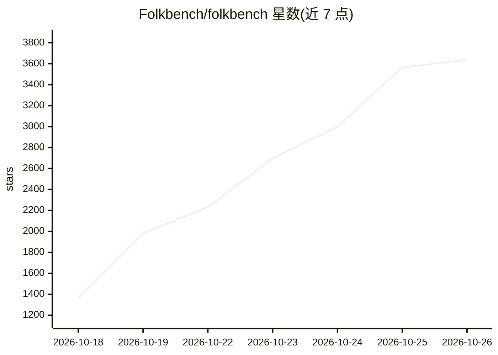

# Folkbench/folkbench

⭐ 3,639 · Rust · NOASSERTION · 推送 2026-10-25 · [GitHub](https://github.com/Folkbench/folkbench) · [官网](https://folkbench.com) · 组织维护 · 中文 README

**AI 中转站评测榜单与桌面配置切换客户端**

仓库包含两部分：folkbench.com 网站持续实测各家 AI API 中转站，公开可用率、响应耗时、价格与数据安全等级，并提供总榜、稳定性榜、性价比榜及单模型排行。配套开源桌面客户端 Folkbench Switch（Tauri + Rust）用于在多个中转站与官方线路间一键切换 Base URL 与 API Key，可写入 Claude Code、Codex、Gemini CLI、Aider 等十余种工具的配置文件，API Key 仅本地存储、离线运行，另提供本地 Token 用量与成本估算。

## 筛选速览

| 维度 | 判定 | 备注 |
|---|---|---|
| AI 角色 | `ai-ecosystem` | LLM/agent 周边工具 |
| 许可风险 | `none` | NOASSERTION |
| 部署形态 | `desktop` | 安装包/桌面程序 |
| 模型依赖 | — | README 未给出锁定关系 |
| 硬件要求 | — | 无带数字的原话,不猜 |
| 安装摩擦 | `low` | 无编译、无系统依赖或容器化 |
| 成熟度 | — | 结构信号不足 |

## 能力要点

- folkbench.com 持续实测各中转站的可用率、延迟与价格并公开榜单
- 一键在多服务商与官方线路间切换 Base URL 与 API Key，支持还原
- 适配 Claude Code、Codex、Gemini CLI、Aider、OpenCode 等 10+ 工具的配置文件
- API Key 仅本地存储、完全离线运行，切换前提供配置差异预览

## 适用场景

- 我在多个 AI 中转站之间切换，不想手动改各工具的配置文件
- 选线路前先看各站点的实时可用率、延迟和价格
- 统计自己各会话的 Token 消耗并估算调用成本

## 场景标签

`模型评测` · 领域:评测与运维

## 证据(README 行号)

> L13: folkbench.com 持续测试各家 AI 中转站，公开可用率、响应耗时和价格。本仓库是配套桌面客户端 **Folkbench Switch** 的代码，用来把选好的线路写入 Claude Code、Codex 等工具的配置。
> L41: Switch 是 Folkbench 配套的开源桌面客户端（基于 Tauri + Rust 构建）。它的核心价值是：**让你在多个中转站和官方线路之间一键切换 Base URL 与 API Key，彻底告别人肉修改配置。**

## 星数曲线

2026-10-18 1,361 → 2026-10-26 3,639（+2,278）

---
*卡片 v1 · prompt 1.4 · 生成 2026-10-21 · 置信度 high · 依据 README sha `67f89b848157` · [字段定义](../../DATASET.md)*
