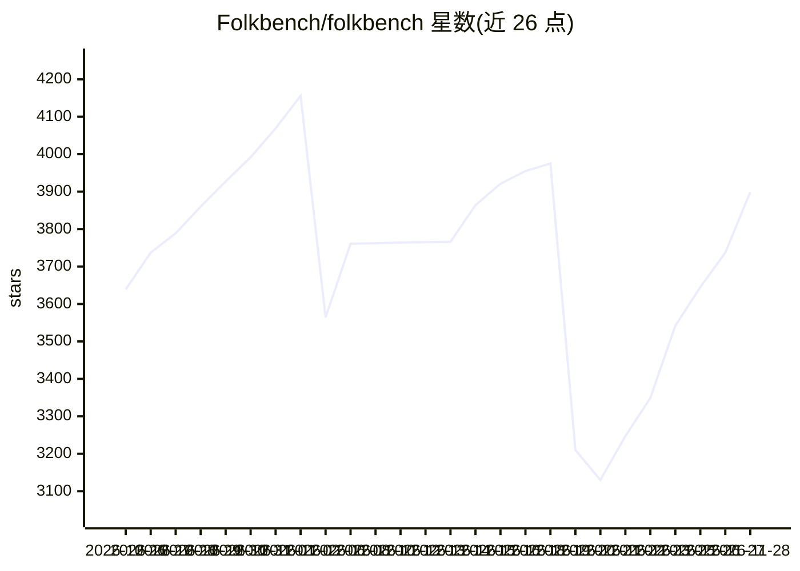

# Folkbench/folkbench

⭐ 3,899 · TypeScript · NOASSERTION · 推送 2026-11-27 · [GitHub](https://github.com/Folkbench/folkbench) · [官网](https://folkbench.com) · 组织维护 · 中文 README

**AI API 中转站评测榜单与本地客户端配置切换工具**

Folkbench 汇集 AI API 中转站的公开目录与每日快照榜单，按模型比较可用率、稳定性、响应速度、会话成本与价格；降智监控通过身份探针的一致率、Token 与模型指纹展示不同线路的表现差异，并附选站指南与充值风险提示。配套 Folkbench Switch 为基于 Tauri + Rust 的开源桌面客户端（Apache-2.0），保存服务商 Base URL 与 API Key，向 Claude Code、Codex、Gemini CLI、Aider 等 8 类工具写入配置，支持差异预览、凭据暂存与本机脱敏。排序含合作档位与运营加权，快照数据承诺可复算。

## 筛选速览

| 维度 | 判定 | 备注 |
|---|---|---|
| AI 角色 | `ai-ecosystem` | LLM/agent 周边工具 |
| 许可风险 | `none` | NOASSERTION |
| 部署形态 | `desktop` | 安装包/桌面程序 |
| 模型依赖 | — | README 未给出锁定关系 |
| 硬件要求 | — | 无带数字的原话,不猜 |
| 安装摩擦 | `low` | 无编译、无系统依赖或容器化 |
| 成熟度 | — | 结构信号不足 |

## 能力要点

- 每日公开快照榜单：可用率、稳定性、价格与会话成本多维比较
- 降智监控：模型身份探针一致率、Token 与模型指纹
- Switch 桌面客户端向 Claude Code / Codex / Gemini CLI / Aider 等写入中转配置
- 本机隐私脱敏：代理请求前替换 API Key、邮箱与 IP

## 适用场景

- 为 Claude Code 或 Codex 挑选并配置中转站线路
- 检测某家中转站的模型是否与标称一致
- 在多家服务商之间一键切换客户端配置

## 场景标签

`模型评测` · 领域:评测与运维

## 证据(README 行号)

> L157: Folkbench 把 AI 中转站的公开目录与榜单快照放在一起，让你按模型比较可用率、稳定性、响应速度和成本。选好线路后，用 **Folkbench Switch** 在本地管理 Claude Code、Codex、Gemin
> L190: Switch 是基于 Tauri + Rust 的开源桌面客户端。保存服务商的 Base URL 与 API Key，预览配置差异，再应用到目标工具；需要时切换线路或恢复原有配置。

## 星数曲线

2026-10-26 3,639 → 2026-11-28 3,899（+260）

---
*卡片 v1 · prompt 1.4 · 生成 2026-11-28 · 置信度 high · 依据 README sha `b29db669d28b` · [字段定义](../../DATASET.md)*
