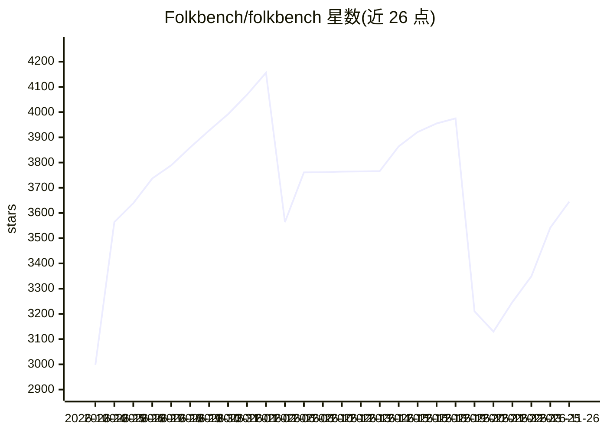

# Folkbench/folkbench

⭐ 3,645 · TypeScript · NOASSERTION · 推送 2026-11-25 · [GitHub](https://github.com/Folkbench/folkbench) · [官网](https://folkbench.com) · 组织维护 · 中文 README

**AI API 中转站评测榜单与桌面配置切换工具**

Folkbench 将 AI API 中转站的公开目录、榜单快照与降智监控聚合在一起，按模型比较各中转站的可用率、稳定性、响应速度与会话成本，并提供模型身份探针一致率、Token 与指纹数据。配套 Folkbench Switch：基于 Tauri + Rust 的开源桌面客户端，保存服务商 Base URL 与 API Key，写入 Claude Code、Codex、Gemini CLI 等 CLI 工具的本地配置文件，支持差异预览、组合档案与凭据暂存恢复。排序规则包含合作档位与运营加权，快照不承诺可复算。

## 筛选速览

| 维度 | 判定 | 备注 |
|---|---|---|
| AI 角色 | `ai-ecosystem` | LLM/agent 周边工具 |
| 许可风险 | `none` | NOASSERTION |
| 部署形态 | `desktop` | 安装包/桌面程序 |
| 模型依赖 | — | README 未给出锁定关系 |
| 硬件要求 | — | 无带数字的原话,不猜 |
| 安装摩擦 | `low` | 无编译、无系统依赖或容器化 |
| 成熟度 | — | 结构信号不足 |

## 能力要点

- 公开快照收录 299 条探针结果，覆盖 17 家站点，含可用率/稳定性/价格
- 降智监控：模型身份探针一致率、Token 与模型指纹
- Switch 桌面客户端适配 Claude Code、Codex、Gemini CLI、Aider 等 7+ 工具配置
- 本机隐私脱敏：代理发出前替换 Key、邮箱、IP 为占位符

## 适用场景

- 为 Claude Code / Codex 选择中转站线路并对比成本
- 检测某个中转站是否存在模型降级
- 在多家服务商之间一键切换 CLI 工具的连接配置

## 场景标签

`模型评测` · 领域:评测与运维

## 证据(README 行号)

> L152: Folkbench 把 AI 中转站的公开目录与榜单快照放在一起，让你按模型比较可用率、稳定性、响应速度和成本。选好线路后，用 **Folkbench Switch** 在本地管理 Claude Code、Codex、Gemin
> L185: Switch 是基于 Tauri + Rust 的开源桌面客户端。保存服务商的 Base URL 与 API Key，预览配置差异，再应用到目标工具；需要时切换线路或恢复原有配置。

## 星数曲线

2026-10-24 2,998 → 2026-11-26 3,645（+647）

---
*卡片 v1 · prompt 1.4 · 生成 2026-11-26 · 置信度 high · 依据 README sha `02305fcb9548` · [字段定义](../../DATASET.md)*
