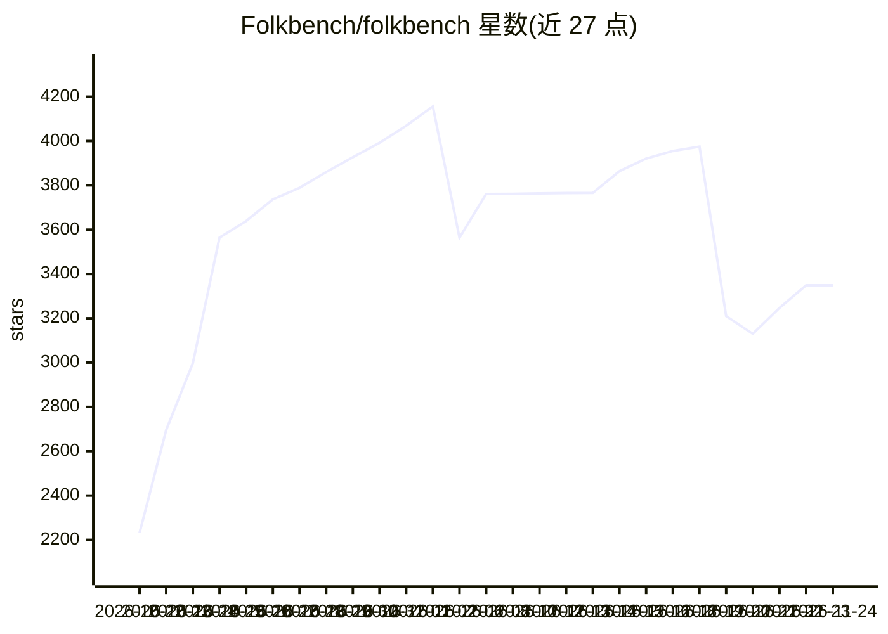

# Folkbench/folkbench

⭐ 3,542 · TypeScript · NOASSERTION · 推送 2026-11-24 · [GitHub](https://github.com/Folkbench/folkbench) · [官网](https://folkbench.com) · 组织维护 · 中文 README

**AI API 中转站评测榜单与配置切换客户端**

Folkbench 提供按模型组织的 AI API 中转站公开榜单（可用率、稳定性、响应速度、会话成本）、每日归档快照与'降智监控'（模型身份探针一致率、Token、模型指纹），并给出选站指南与充值风险提示。配套 Folkbench Switch：基于 Tauri + Rust 的开源桌面客户端，保存中转站 Base URL 与 API Key，写入 Claude Code、Codex、Gemini CLI、Aider 等工具的配置文件，支持凭据暂存、组合档案与本机脱敏代理。榜单排序含合作档位与运营加权；客户端代码 Apache-2.0。

## 筛选速览

| 维度 | 判定 | 备注 |
|---|---|---|
| AI 角色 | `ai-knowledge` | 知识聚合/清单类 |
| 许可风险 | `none` | NOASSERTION |
| 部署形态 | `desktop` | 安装包/桌面程序 |
| 模型依赖 | — | README 未给出锁定关系 |
| 硬件要求 | — | 无带数字的原话,不猜 |
| 安装摩擦 | `low` | 无编译、无系统依赖或容器化 |
| 成熟度 | — | 结构信号不足 |

## 能力要点

- 按模型比较中转站可用率、稳定性、价格与会话成本的每日公开快照
- 降智监控：探针一致率、输入/思考 Token 与模型指纹
- Switch 客户端写入 7+ 编码工具的本地配置，支持 Codex OAuth 凭据暂存恢复
- 可选本机脱敏代理，请求发出前替换 API Key、邮箱与公网 IP

## 适用场景

- 为 Claude Code / Codex / Gemini CLI 选择并切换中转站线路
- 核验某个中转站接口的可用率与模型一致性
- 对比同一模型在不同中转站的标价与实测成本

## 场景标签

`模型评测` · 领域:评测与运维

## 证据(README 行号)

> L54: ### 中转站排行榜
> L62: > 归档日期：2026-11-23 · 发布：2026-11-23 20:30:34（北京时间）· 快照：`public-f5985dcf94b2c542877ec4a7c72592b7049c96902e22e918b2facd
> L149: Folkbench 把 AI 中转站的公开目录与榜单快照放在一起，让你按模型比较可用率、稳定性、响应速度和成本。选好线路后，用 **Folkbench Switch** 在本地管理 Claude Code、Codex、Gemin

## 星数曲线

2026-10-22 2,232 → 2026-11-24 3,349（+1,117）

---
*卡片 v1 · prompt 1.4 · 生成 2026-11-24 · 置信度 mid · 依据 README sha `86ab8d2418f9` · [字段定义](../../DATASET.md)*
