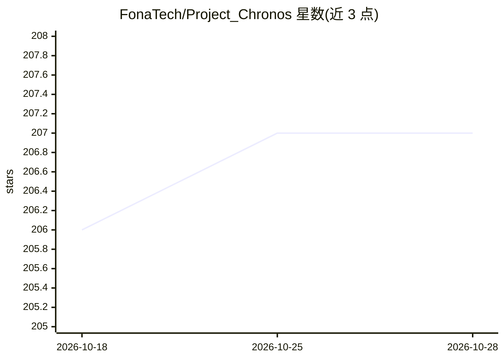

# FonaTech/Project_Chronos

⭐ 207 · Python · Apache-2.0 · 推送 2026-04-26 · [GitHub](https://github.com/FonaTech/Project_Chronos) · 组织维护 · 中文 README

**面向 SSD+DRAM 混合存储的 MoE 推理与六阶段训练框架**

为消费级硬件上的 MoE 模型提供存储感知的推理与训练栈：通过 IntentClassifier 在 prefill 阶段批量预载预测专家、LookaheadRouter 逐 token 预测未来路由，配合异步 DMA 预取与专家级事件同步，将 IO 从解码关键路径移出；采用 Louvain 聚类的 .ctsr 簇打包 safetensors 三级存储，缓存未命中时软门控降级而非硬停。附带六阶段训练流水线（Pretrain/SFT/DPO/ORPO/GRPO/蒸馏），后端覆盖 cpu/mps/cuda/mlx，兼容 Hugging Face AutoModel 与 vLLM 注册适配。README 标注为实验性项目。

## 筛选速览

| 维度 | 判定 | 备注 |
|---|---|---|
| AI 角色 | `ai-ecosystem` | LLM/agent 周边工具 |
| 许可风险 | `permissive` | Apache-2.0 |
| 部署形态 | `library` | 以包/库形式分发 |
| 模型依赖 | local-ok | 支持本地模型 |
| 硬件要求 | — | 无带数字的原话,不猜 |
| 安装摩擦 | `medium` | 含编译或系统依赖之一 |
| 成熟度 | `idea` | |

## 能力要点

- Prefill 期专家预载 + 双层路由（IntentClassifier + LookaheadRouter）
- Louvain 聚类 .ctsr 簇打包 safetensors 三级存储（VRAM/RAM/SSD）
- 六阶段训练流水线（Pretrain/SFT/DPO/ORPO/GRPO/蒸馏）含 router KL anchor
- cpu/mps/cuda/mlx 后端调度，兼容 Hugging Face 与 vLLM 注册适配

## 适用场景

- 在 VRAM 不足的消费级硬件上运行 MoE 大模型推理
- 训练带负载均衡与时序局部性约束的 MoE 模型
- 在 Apple Silicon 上通过 MLX 后端做 MoE 训练与推理

## 场景标签

`推理引擎` `微调` `强化学习` `模型训练` · 领域:训练与推理

## 证据(README 行号)

> L3: **A storage-aware MoE stack built for SSD+DRAM hybrid inference, with a full six-stage training pipeline.**
> L148: - **First-class backends for training and inference**: `cpu`, `mps`, `cuda`, `mlx`
> L193: - `chronos.serving.register_chronos_with_vllm()` registers Chronos with the vLLM `ModelRegistry` when vLLM is inst

## 星数曲线

2026-10-18 206 → 2026-10-28 207（+1）

---
*卡片 v1 · prompt 1.4 · 生成 2026-10-22 · 置信度 high · 依据 README sha `6ed50045513a` · [字段定义](../../DATASET.md)*
