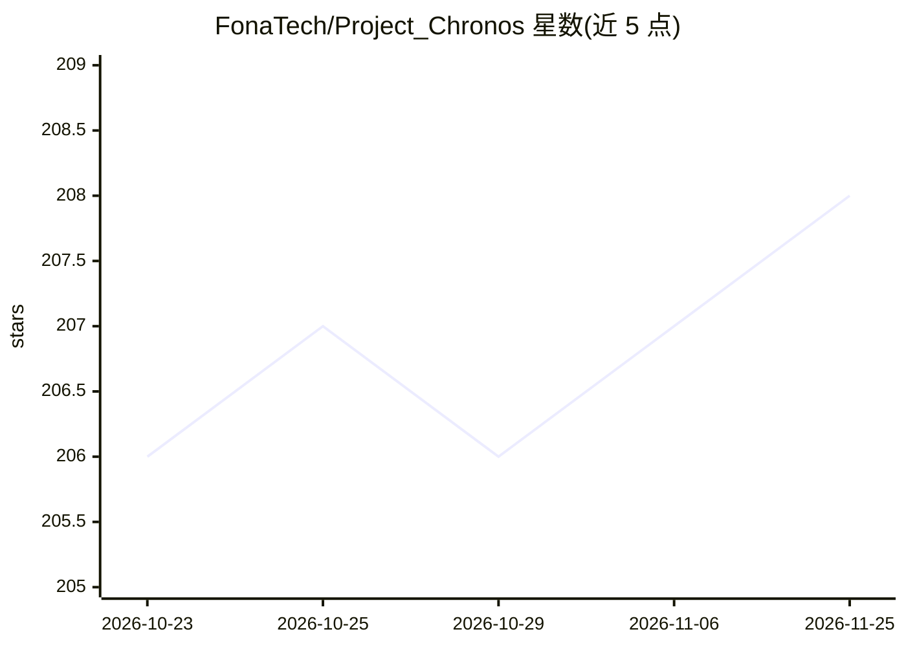

# FonaTech/Project_Chronos

⭐ 208 · Python · Apache-2.0 · 推送 2026-11-18 · [GitHub](https://github.com/FonaTech/Project_Chronos) · 个人维护 · 中文 README

**面向 SSD+DRAM 混合推理的存储感知 MoE 训练与推理栈**

Project Chronos 提供一套存储感知的 MoE（混合专家）栈：针对 SSD+DRAM 混合推理场景，将专家权重 IO 提前到 prefill 阶段批量加载，按专家粒度做事件级同步（torch.cuda.Event），并用 lookahead 路由预测未来 token 所需专家、由 Prefetch/驻留策略管理专家页加载与淘汰。v3 内核采用循环深度架构（少量物理层复用多次），支持 MLA+滑窗注意力、自推测解码、int8 KV 缓存，提供 Torch 与 MLX 双后端、chronos tokenizer/serve/monitor 等工具与 Web UI，含六阶段训练流程。以 PyPI 包发布，提供完整文档体系与中英翻译 demo。

## 筛选速览

| 维度 | 判定 | 备注 |
|---|---|---|
| AI 角色 | `ai-ecosystem` | LLM/agent 周边工具 |
| 许可风险 | `permissive` | Apache-2.0 |
| 部署形态 | `library` | 以包/库形式分发 |
| 模型依赖 | local-ok | 支持本地模型 |
| 硬件要求 | — | 无带数字的原话,不猜 |
| 安装摩擦 | `medium` | 含编译或系统依赖之一 |
| 成熟度 | `idea` | |

## 能力要点

- Prefill 阶段批量加载预测专家 + 按专家粒度 CUDA Event 同步，消除解码期 SSD IO 停顿
- 循环深度架构：6 物理层执行 18 虚拟层，支持自推测解码（无需额外参数）
- Torch 与 MLX 双后端，MLX↔Torch bf16 桥接位精确
- chronos serve 提供 Ollama/OpenAI 协议服务器，配套 Web UI 与训练监控

## 适用场景

- 在消费级硬件（SSD+有限显存）上运行超出显存容量的 MoE 模型
- 从小规模训练 MoE 模型并验证循环深度/推测解码等机制
- 通过 Ollama/OpenAI 协议对外提供本地模型推理服务

## 场景标签

`微调` `推理引擎` · 领域:训练与推理

## 证据(README 行号)

> L3: **A storage-aware MoE stack built for SSD+DRAM hybrid inference, with a full six-stage training pipeline.**
> L40: Mainstream MoE models such as Mixtral, DeepSeek-MoE, and Qwen-MoE make routing decisions **at decode time, token by
> L109: |`chronos serve`|Ollama/OpenAI protocol server on the native runtime (see below)|

## 星数曲线

2026-10-23 206 → 2026-11-25 208（+2）

---
*卡片 v1 · prompt 1.4 · 生成 2026-11-25 · 置信度 high · 依据 README sha `df47823340cf` · [字段定义](../../DATASET.md)*
