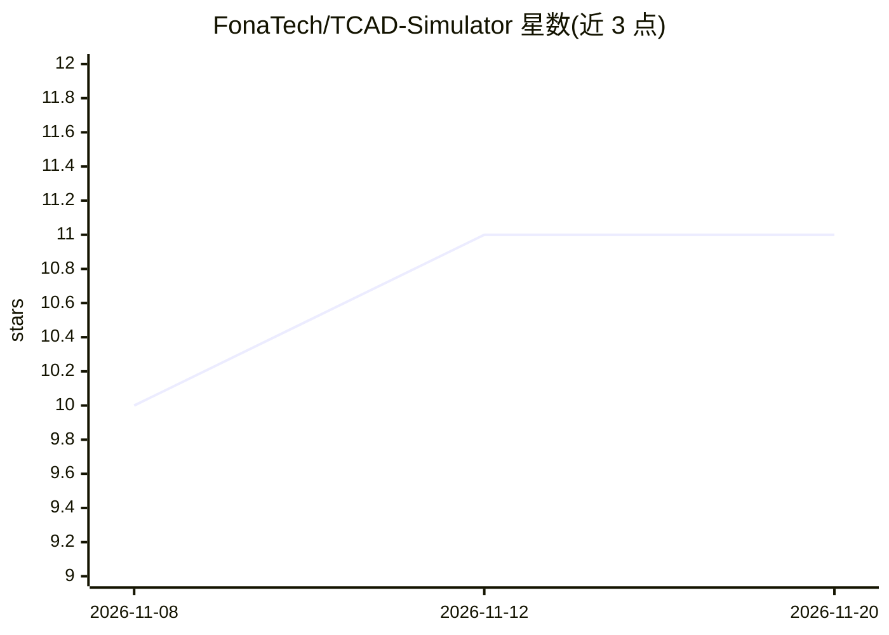

# FonaTech/TCAD-Simulator

⭐ 11 · Python · MIT · 推送 2026-05-19 · [GitHub](https://github.com/FonaTech/TCAD-Simulator) · 个人维护 · 中文 README

**面向半导体工艺研发的体素化 TCAD-like 工艺仿真平台**

单文件 Python 应用 `tcad_simulator.py`，将工艺 recipe 编辑、体素晶圆建模（可配置 NX×NY×NZ 网格、纳米级 voxel、掺杂/缺陷场）、光刻/掩膜流程、沉积、刻蚀、CMP、离子注入、退火、氧化/氮化、测量与 3D/2D 可视化集于一体，提供 PyQt5 桌面 GUI、多用户 WebUI 与导出工具。LLM 部分（文献摄取、本地检索、physics audit、recipe 草拟）为可选功能。README 明确说明数值模型为 physics-inspired，非经过工业标定的商业 TCAD sign-off 工具。

## 筛选速览

| 维度 | 判定 | 备注 |
|---|---|---|
| AI 角色 | `ai-enhanced` | 去掉 AI 部分产品仍成立 |
| 许可风险 | `permissive` | MIT |
| 部署形态 | `library` | 以包/库形式分发 |
| 模型依赖 | — | README 未给出锁定关系 |
| 硬件要求 | — | 无带数字的原话,不猜 |
| 安装摩擦 | `medium` | 含编译或系统依赖之一 |
| 成熟度 | — | 结构信号不足 |

## 能力要点

- 体素化工艺内核：纳米级 voxel、材料网格、高度图、掺杂/缺陷场与快照
- 覆盖光刻/掩膜、沉积、刻蚀、CMP、注入、退火、氧化等完整制程步骤
- 同时提供 PyQt5 桌面 GUI 与多用户 WebUI，支持加密库存储
- 可选 LLM 辅助 recipe 草拟与 PDF 文献摄取、本地检索、physics audit

## 适用场景

- 半导体制造工艺流程的教学与研究探索
- 光刻/掩膜流程与工艺窗口的建模演练
- 工艺 recipe 的编辑、导入导出与团队 WebUI 协作

## 场景标签

 · 领域:半导体/EDA 工艺仿真

## 证据(README 行号)

> L14: `tcad_simulator.py` is the canonical single-file application. It combines process recipe editing, voxel-based wafer
> L62: The numerical model is physics-inspired and designed for research, teaching, and process exploration. It is not a c

## 星数曲线

2026-11-08 10 → 2026-11-20 11（+1）

---
*卡片 v1 · prompt 1.4 · 生成 2026-11-19 · 置信度 high · 依据 README sha `6cf64c4fe765` · [字段定义](../../DATASET.md)*
