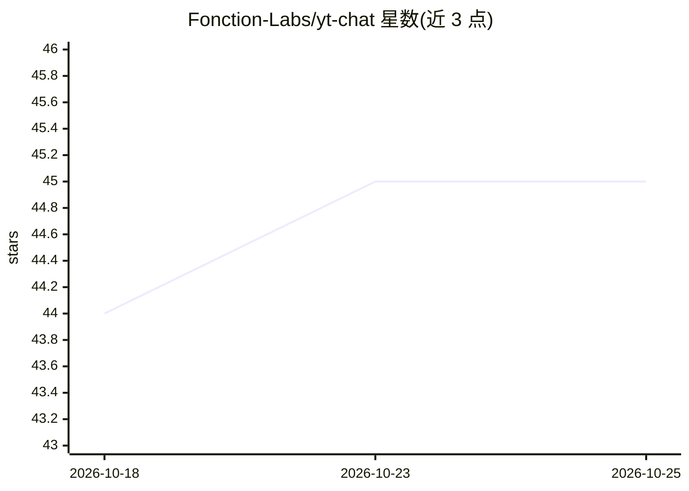

# Fonction-Labs/yt-chat

⭐ 45 · Python · GPL-3.0 · 推送 2026-09-25 · [GitHub](https://github.com/Fonction-Labs/yt-chat) · [官网](https://yt.chat) · 组织维护

**供 Codex/Claude Code 使用的 YouTube 视频总结问答技能**

以 AI skill 形式提供的工具：Python 脚本抓取 YouTube 视频公开字幕，生成带时间戳链接的 Markdown 转写文本，由宿主 AI 助手（Codex 或 Claude Code）据此总结视频或回答提问。支持视频 ID 与 youtu.be/shorts/live 链接，默认优先法语字幕，先尝试 youtube-transcript-api 再回退 yt-dlp。早期 Chainlit 聊天应用、模型配置、Qdrant、Docker 与 Poetry 均已移除，旧版安装命令不再有效；脚本不自行转写音频，依赖 YouTube 公开字幕的可得性。

## 筛选速览

| 维度 | 判定 | 备注 |
|---|---|---|
| AI 角色 | `ai-ecosystem` | LLM/agent 周边工具 |
| 许可风险 | `viral` | GPL-3.0 |
| 部署形态 | `self-host` | docker 或自建部署 |
| 模型依赖 | — | README 未给出锁定关系 |
| 硬件要求 | — | 无带数字的原话,不猜 |
| 安装摩擦 | `low` | 无编译、无系统依赖或容器化 |
| 成熟度 | — | 结构信号不足 |

## 能力要点

- Python 脚本抓取公开字幕并输出带时间戳链接的 Markdown
- 支持 --from/--to 时间区间截取片段
- 字幕获取先经 youtube-transcript-api，失败后回退 yt-dlp
- 安装到 Codex/Claude Code 的 skills 目录，复用助手既有模型

## 适用场景

- 在 Codex 或 Claude Code 中粘贴 YouTube 链接获取视频总结
- 针对视频内容向 AI 助手提问
- 导出视频指定时间段的字幕文本片段

## 场景标签

`网页抓取` · 领域:效率与自动化

## 证据(README 行号)

> L4:  Paste a YouTube link. Codex or Claude Code can summarize the video and answer your questions.
> L10: yt-chat now does two things: a small Python script fetches a video's public captions, and your AI assistant uses th
> L14: Clone or copy this repository to `~/.codex/skills/yt-chat` for Codex, or `~/.claude/skills/yt-chat` for Claude Code

## 星数曲线

2026-10-18 44 → 2026-10-25 45（+1）

---
*卡片 v1 · prompt 1.4 · 生成 2026-10-25 · 置信度 mid · 依据 README sha `9a39f34bc559` · [字段定义](../../DATASET.md)*
