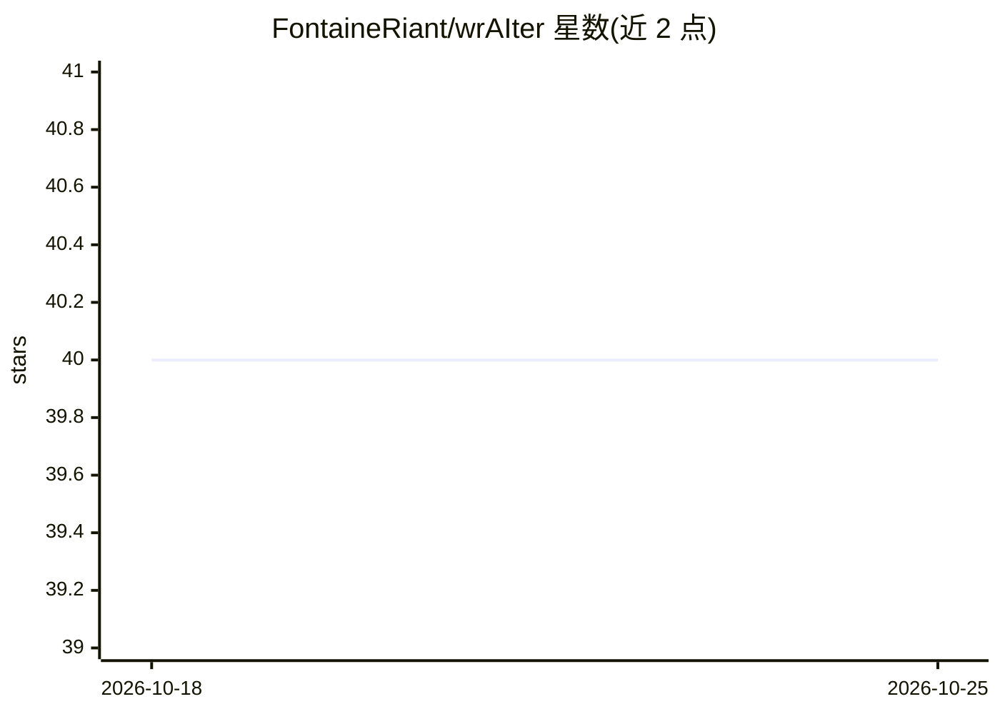

# FontaineRiant/wrAIter

⭐ 40 · Python · MPL-2.0 · 推送 2026-08-23 · [GitHub](https://github.com/FontaineRiant/wrAIter) · 个人维护

**本地运行的语音互动 AI 故事写作助手**

面向终端用户的故事写作工具：用户与 LLM 交替续写小说，支持键盘输入、选择 AI 生成选项和麦克风语音三种输入方式。写作模型默认为 Hugging Face 上 2.7B 参数的故事微调模型，可命令行切换。附带 TTS 旁白（可自定义声音样本、多角色分声、按性别分配）、Stable Diffusion 1.4 插图（ctrl+o 生成）、角色对话模式与存档/回退功能。全部模型本地运行，默认开启审查器。安装通过 install.ps1/install.sh 脚本，需 Python 3.10+，建议 8GB 显存 GPU。

## 筛选速览

| 维度 | 判定 | 备注 |
|---|---|---|
| AI 角色 | `ai-native` | 本体是模型或模型工具 |
| 许可风险 | `permissive` | MPL-2.0 |
| 部署形态 | `None` |  |
| 模型依赖 | — | README 未给出锁定关系 |
| 硬件要求 | — | 无带数字的原话,不猜 |
| 安装摩擦 | `medium` | 含编译或系统依赖之一 |
| 成熟度 | — | 结构信号不足 |

## 能力要点

- 人机交替续写故事，三种输入模式（打字/选项/麦克风）
- TTS 多角色朗读，可自定义 WAV 声音样本
- Stable Diffusion 1.4 插图，settings.json 可换模型
- 模型全部本地运行，不上传数据

## 适用场景

- 和 AI 一起接力创作小说并听旁白朗读
- 通过对话模式与虚构角色聊天
- 本地隐私优先的互动小说体验

## 场景标签

`AI 写作` `语音合成` `图像生成` · 领域:内容生成

## 证据(README 行号)

> L3: wrAIter is a voiced AI that writes stories while letting the user interact and add to the story.
> L9: The AI writer is powered by any LLM that can be found on Hugging Face, easily swappable through a command line argum

## 星数曲线

2026-10-18 40 → 2026-10-25 40（+0）

---
*卡片 v1 · prompt 1.4 · 生成 2026-10-25 · 置信度 high · 依据 README sha `32fa2c41bae7` · [字段定义](../../DATASET.md)*
