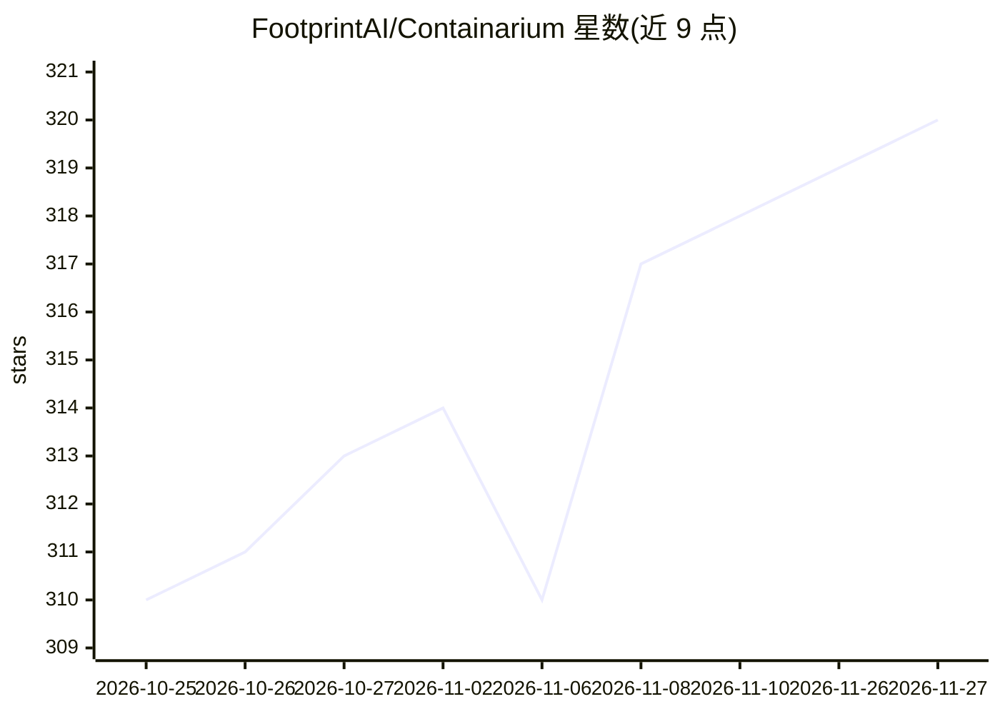

# FootprintAI/Containarium

⭐ 320 · Go · Apache-2.0 · 推送 2026-11-24 · [GitHub](https://github.com/FootprintAI/Containarium) · [官网](https://containarium.dev) · 组织维护

**为 AI agent 提供隔离沙箱运行时的自托管平台**

自托管的 agent 运行时平台：为每个 agent 在无特权容器（LXC 或 Kubernetes 后端）中提供持久、可通过 SSH 访问的沙箱环境，配合 eBPF 出站策略与审计日志，并内置模型网关使 provider API key 不进入沙箱。管理面通过 MCP server 暴露，容器内另运行 agent-box MCP server 提供 shell_exec、文件读写等工具；支持将 Claude Code 安装进沙箱并支持断线重连的输出流。安装脚本面向 Ubuntu 24.04 VM，另有托管云版本。

## 筛选速览

| 维度 | 判定 | 备注 |
|---|---|---|
| AI 角色 | `ai-ecosystem` | LLM/agent 周边工具 |
| 许可风险 | `permissive` | Apache-2.0 |
| 部署形态 | `None` |  |
| 模型依赖 | — | README 未给出锁定关系 |
| 硬件要求 | — | 无带数字的原话,不猜 |
| 安装摩擦 | `low` | 无编译、无系统依赖或容器化 |
| 成熟度 | — | 结构信号不足 |

## 能力要点

- 每个 agent 一个持久、SSH 可达的无特权容器沙箱
- eBPF 出站策略与审计日志、模型网关隔离 API key
- MCP-native：平台管理面与容器内 agent-box 双 MCP server
- agent 运行输出可断线重连、字节级精确回放

## 适用场景

- 给 coding agent 一个不占用本机的持久构建/测试环境
- 让 agent 在沙箱中构建并对外发布 HTTPS 应用
- 为团队提供自托管的 agent 基础设施并限制出站行为

## 场景标签

 · 领域:AI 基础设施/agent 运行时

## 证据(README 行号)

> L5: **The open-source, self-hostable agent runtime for AI agents.**
> L59: platform on LXC or Kubernetes, exposes its admin surface over MCP, and

## 星数曲线

2026-10-25 310 → 2026-11-27 320（+10）

---
*卡片 v1 · prompt 1.4 · 生成 2026-11-25 · 置信度 high · 依据 README sha `1fc57242e14a` · [字段定义](../../DATASET.md)*
