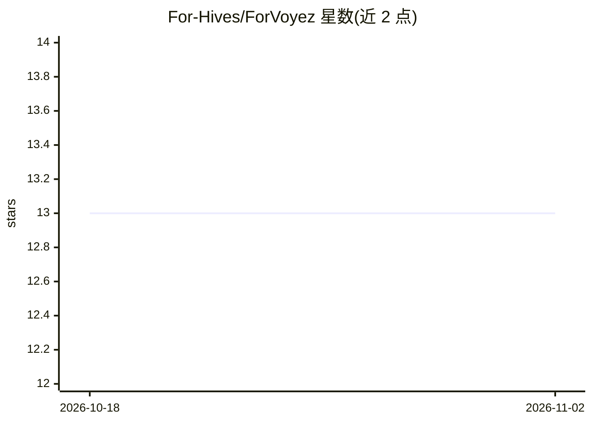

# For-Hives/ForVoyez

⭐ 13 · JavaScript · 推送 2026-11-01 · [GitHub](https://github.com/For-Hives/ForVoyez) · [官网](https://forvoyez.com/) · 组织维护

**为图片自动生成 SEO 元数据（替代文本/标题/说明）的 SaaS 平台**

基于 Next.js 的 SaaS 平台：通过 API 接收 JPEG/PNG/WebP/GIF 图片，用 OpenAI 视觉模型生成 SEO 优化的替代文本、标题与说明文字，以可自定义的 JSON schema 返回；配套 token 认证、用量统计、按量计费（Lemon Squeezy 订阅与 webhook 处理）和 API playground。面向需要批量补全图片元数据以提升搜索排名的网站运营者与开发者。本地开发需 Node.js、pnpm 与 PostgreSQL，提供模型对比脚本与测试体系。

## 筛选速览

| 维度 | 判定 | 备注 |
|---|---|---|
| AI 角色 | `ai-native` | 本体是模型或模型工具 |
| 许可风险 | `none` | — |
| 部署形态 | `self-host` | docker 或自建部署 |
| 模型依赖 | — | README 未给出锁定关系 |
| 硬件要求 | — | 无带数字的原话,不猜 |
| 安装摩擦 | `low` | 无编译、无系统依赖或容器化 |
| 成熟度 | — | 结构信号不足 |

## 能力要点

- 自动生成 SEO 友好的替代文本、标题与说明文字
- 支持 JPEG/PNG/WebP/GIF，输出可自定义 JSON schema
- API token 认证、用量统计与交互式 API playground
- Lemon Squeezy 订阅计费与 webhook 事件持久化/重放机制

## 适用场景

- 我为网站图片批量补全 alt 文本提升搜索排名
- 我把图片元数据生成接入现有内容工作流（JSON API）
- 我作为团队按用量选择计费方案并监控使用统计

## 场景标签

`图像视频处理` · 领域:感知与多模态

## 证据(README 行号)

> L7: ForVoyez is a powerful SaaS platform that automatically generates SEO-optimized alternative text, titles, and captio
> L94: `scripts/compare-models.mjs` runs the previous pipeline (3 sequential `gpt-4o-mini` calls, kept in `scripts/legacy-

## 星数曲线

2026-10-18 13 → 2026-11-02 13（+0）

---
*卡片 v1 · prompt 1.4 · 生成 2026-10-31 · 置信度 mid · 依据 README sha `6aecd6e1e14a` · [字段定义](../../DATASET.md)*
