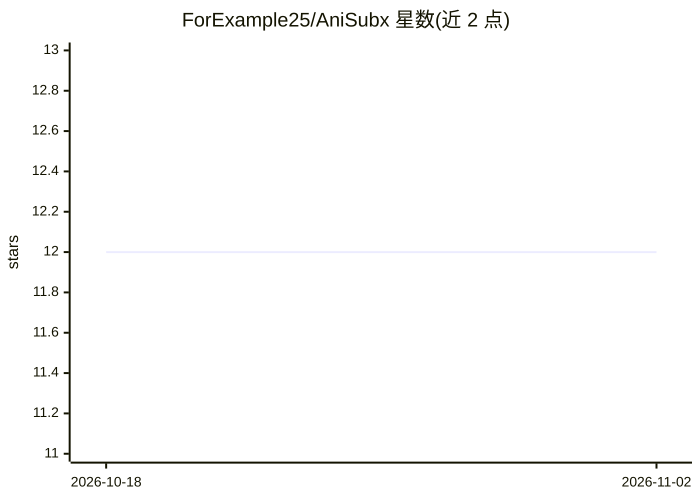

# ForExample25/AniSubx

⭐ 12 · Python · AGPL-3.0 · 推送 2026-08-20 · [GitHub](https://github.com/ForExample25/AniSubx) · 个人维护

**自托管 Web 应用：视频语音转波斯语字幕并 LLM 翻译**

轻量自托管的 FastAPI Web 应用，面向个人用户（主要为 Termux/Android 设计）：从视频或音频提取声音，发送到用户自选的 OpenAI 协议兼容 STT 服务转写文本，再用 chat/completions 兼容的 LLM API 翻译为波斯语，生成 SRT 字幕，并可用 FFmpeg/libass 将字幕烧录进视频输出 MP4。全程在本机运行、使用用户自己的 API key，无数据库/Redis/Celery 依赖；单后台 worker 处理任务队列，任务状态落盘可断点续传。界面为波斯语/英语双语 PWA，无密码保护。

## 筛选速览

| 维度 | 判定 | 备注 |
|---|---|---|
| AI 角色 | `ai-native` | 本体是模型或模型工具 |
| 许可风险 | `viral` | AGPL-3.0 |
| 部署形态 | `library` | 以包/库形式分发 |
| 模型依赖 | local-ok | 支持本地模型 |
| 硬件要求 | — | 无带数字的原话,不猜 |
| 安装摩擦 | `medium` | 含编译或系统依赖之一 |
| 成熟度 | — | 结构信号不足 |

## 能力要点

- 语音转文字与翻译均走 OpenAI 协议兼容 API（自选服务商与模型）
- 生成 UTF-8 右对齐波斯语 SRT，可用 FFmpeg+libass 烧录字幕
- 任务队列落盘存储，失败/中断任务可续传不重复翻译
- 可安装为 PWA，双语（波斯语/英语）界面

## 适用场景

- 在手机（Termux）或自有服务器上给视频生成波斯语字幕
- 选择 SRT 文件或烧录字幕的 MP4 两种输出方式
- 对接 OpenAI/Groq/OpenRouter/Ollama 等兼容服务完成转写与翻译

## 场景标签

`语音识别` `AI 写作` · 领域:内容生成

## 证据(README 行号)

> L46: 2. آن را برای تبدیل گفتار به متن (speech-to-text) به سرویسی که خودتان معرفی می‌کنید می‌فرستد.
> L47: 3. متن پیاده‌شده را با یک مدل زبانی (LLM) به فارسی ترجمه می‌کند.
> L48: 4. فایل زیرنویس `.srt` می‌سازد و در صورت درخواست، زیرنویس را با FFmpeg روی ویدیو «حک» (داخلی/burn) می‌کند و یک MP4 

## 星数曲线

2026-10-18 12 → 2026-11-02 12（+0）

---
*卡片 v1 · prompt 1.4 · 生成 2026-11-01 · 置信度 mid · 依据 README sha `2dca000af1b3` · [字段定义](../../DATASET.md)*
