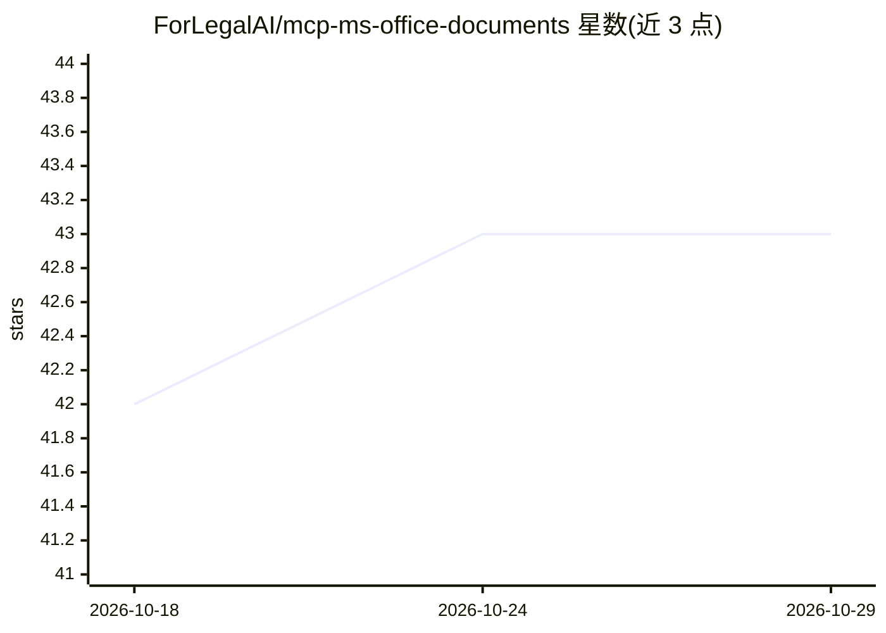

# ForLegalAI/mcp-ms-office-documents

⭐ 43 · Python · MIT · 推送 2026-10-25 · [GitHub](https://github.com/ForLegalAI/mcp-ms-office-documents) · 组织维护

**MCP 服务器：让 AI 助手生成 Office 文档与邮件**

以 Docker 运行的 MCP 服务器，向 Claude Desktop、Cursor、LibreChat 等 MCP 客户端暴露工具，生成 PowerPoint、Word、Excel、EML 邮件与 XML 文件。PowerPoint 工具支持 14 种幻灯片类型与图表，Word/Excel 工具以 Markdown 为输入并支持表格、公式、目录等；另可将带占位符的 Word/邮件模板注册为独立工具。输出可存本地或上传 S3/GCS/Azure/MinIO 并返回限时下载链接。通过 .env 配置，默认本地输出。

## 筛选速览

| 维度 | 判定 | 备注 |
|---|---|---|
| AI 角色 | `ai-ecosystem` | LLM/agent 周边工具 |
| 许可风险 | `permissive` | MIT |
| 部署形态 | `self-host` | docker 或自建部署 |
| 模型依赖 | — | README 未给出锁定关系 |
| 硬件要求 | — | 无带数字的原话,不猜 |
| 安装摩擦 | `low` | 无编译、无系统依赖或容器化 |
| 成熟度 | — | 结构信号不足 |

## 能力要点

- 5 类文档生成工具（pptx/docx/xlsx/eml/xml），Markdown 输入转 Word/Excel
- 14 种幻灯片类型的类型化幻灯片 schema
- 带 {{占位符}} 的 Word/邮件模板可注册为独立 AI 工具
- 输出支持本地或 S3/GCS/Azure/MinIO 云存储及限时下载链接

## 适用场景

- 让 Claude/Cursor 等 AI 客户端一句话生成演示文稿、报告或邮件草稿
- 复用参数化邮件与 Word 模板批量生成文档
- 将生成文件统一上传云存储并分享限时链接

## 场景标签

`AI 写作` · 领域:内容生成

## 证据(README 行号)

> L13: This is an **MCP (Model Context Protocol) server** that runs in Docker and gives AI assistants (like Claude, Cursor
> L64: docker compose up -d

## 星数曲线

2026-10-18 42 → 2026-10-29 43（+1）

---
*卡片 v1 · prompt 1.4 · 生成 2026-10-25 · 置信度 high · 依据 README sha `b6cc9e67655c` · [字段定义](../../DATASET.md)*
