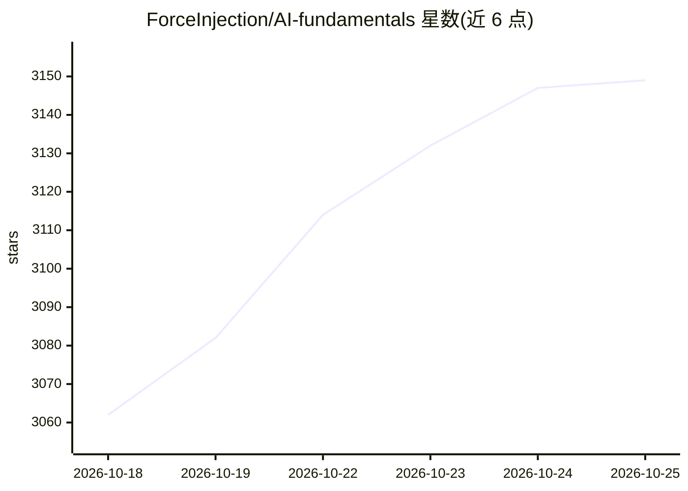

# ForceInjection/AI-fundamentals

⭐ 3,156 · HTML · Apache-2.0 · 推送 2026-10-25 · [GitHub](https://github.com/ForceInjection/AI-fundamentals) · [官网](https://forceinjection.github.io) · 个人维护 · 中文 README

**AI 基础设施与 LLM 全栈知识仓库：硬件/CUDA/训练/推理学习资源合集**

由个人维护的中文 AI 学习资源集合，按 9 大主题组织：GPU 架构与互连、AI 集群运维与 NCCL 通信、Kubernetes 云原生 AI 基础设施、CUDA/TileLang/DPU/昇腾 NPU 编程、LLM 应用开发与编排、机器学习基础、LLM 理论、大模型训练与推理。条目以文章链接、书籍与课程为主，覆盖 NVIDIA/华为昇腾生态与 DeepSeek 3FS、Mooncake、vLLM 等系统解析；仓库含 12 处可运行 Demo 索引。本 README 本身不含本仓库的安装命令，内容以链接导航形式呈现。

## 筛选速览

| 维度 | 判定 | 备注 |
|---|---|---|
| AI 角色 | `ai-knowledge` | 知识聚合/清单类 |
| 许可风险 | `permissive` | Apache-2.0 |
| 部署形态 | `None` |  |
| 模型依赖 | — | README 未给出锁定关系 |
| 硬件要求 | — | 无带数字的原话,不猜 |
| 安装摩擦 | `medium` | 含编译或系统依赖之一 |
| 成熟度 | — | 结构信号不足 |

## 能力要点

- 9 大主题覆盖硬件架构、CUDA/NPU 编程、训练与推理全链路
- 含 12 处可运行 Demo 的总索引（依赖要求与验证状态）
- 覆盖华为昇腾 CANN 工具链与 Qwen2.5 NPU 推理/微调实战
- 收录 KV Cache 论文精读与推理系统架构解析系列

## 适用场景

- 系统学习 AI 基础设施从芯片到推理部署的技术栈
- 查找 CUDA 编程与 GPU 资源虚拟化的学习路径
- 了解 LLM 训练、微调与推理系统的工程实践资料

## 场景标签

`教程课程` `精选清单` · 领域:学习与行业

## 证据(README 行号)

> L3: 本仓库是一个全面的人工智能基础设施（AI Infrastructure）学习资源集合，涵盖从硬件基础到高级应用的完整技术栈。内容包括 GPU 架构与编程、CUDA 开发、大语言模型、AI 系统设计、性能优化、企业级部署等核心领域，旨
> L15: 涵盖单机基础计算芯片（GPU、TPU）设计原理，PCIe、NVLink 高速互连总线协议，GPUDirect 跨节点直通技术，以及 NVIDIA GB300 NVL72 等异构融合超级芯片的系统级架构与延迟金字塔模型。详细内容请访
> L219: LLM 核心理论与架构基石，深入解析 Tokenizer 分词机制、Embedding 向量表示学习、混合专家模型 (MoE) 与模型压缩量化技术，并前瞻思维链 (CoT) 推理增强、基于 LLM 的意图识别及 Deep Res

## 星数曲线

2026-10-18 3,062 → 2026-10-25 3,149（+87）

---
*卡片 v1 · prompt 1.4 · 生成 2026-10-21 · 置信度 high · 依据 README sha `89ce3489d02d` · [字段定义](../../DATASET.md)*
