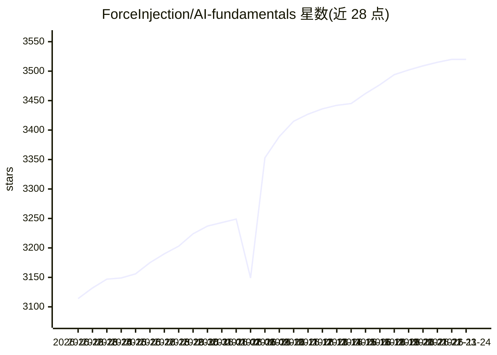

# ForceInjection/AI-fundamentals

⭐ 3,532 · HTML · Apache-2.0 · 推送 2026-11-23 · [GitHub](https://github.com/ForceInjection/AI-fundamentals) · [官网](https://forceinjection.github.io) · 个人维护 · 中文 README

**面向 AI 工程师的 GPU/CUDA/LLM 基础设施学习资源库**

以中文组织的人工智能基础设施知识库，按八个章节编排学习路径：硬件架构与互连、集群运维与 NCCL 通信、Kubernetes 云原生 AI 平台、GPU/CUDA/DPU/NPU 编程、LLM 应用开发编排、机器学习基础、LLM 理论、大模型训练。内容以文章链接、文档门户和 12 处可运行 Demo 索引的形式提供，收录外部教程与实战 Notebook（如 LangGraph 客服系统、Qwen2 微调）。自身不提供软件安装，定位为学习路径与实践指导合集。

## 筛选速览

| 维度 | 判定 | 备注 |
|---|---|---|
| AI 角色 | `ai-knowledge` | 知识聚合/清单类 |
| 许可风险 | `permissive` | Apache-2.0 |
| 部署形态 | `None` |  |
| 模型依赖 | — | README 未给出锁定关系 |
| 硬件要求 | — | 无带数字的原话,不猜 |
| 安装摩擦 | `medium` | 含编译或系统依赖之一 |
| 成熟度 | — | 结构信号不足 |

## 能力要点

- 覆盖硬件到应用的完整技术栈章节体系（8 章）
- 全仓库 12 处可运行 Demo 总索引，含依赖要求与验证状态
- 含 GPU 虚拟化、HAMi、TileLang 等专题的子门户与代码参考实现

## 适用场景

- 系统学习 GPU 架构与 CUDA 编程
- 搭建 Kubernetes 上的 AI 集群与推理调度
- 准备大模型训练与微调的工程实践

## 场景标签

`教程课程` `精选清单` · 领域:学习与行业

## 证据(README 行号)

> L3: 本仓库是一个全面的人工智能基础设施（AI Infrastructure）学习资源集合，涵盖从硬件基础到高级应用的完整技术栈。内容包括 GPU 架构与编程、CUDA 开发、大语言模型、AI 系统设计、性能优化、企业级部署等核心领域，旨
> L5: > - **适用人群**：AI 工程师、系统架构师、GPU 编程开发者、大模型应用开发者、技术研究人员。
> L7: > - **想直接跑代码？** 全仓库 12 处可运行 Demo 的总索引见 **Demos 总索引**——含依赖要求、对应文章与验证状态。

## 星数曲线

2026-10-22 3,114 → 2026-11-24 3,520（+406）

---
*卡片 v1 · prompt 1.4 · 生成 2026-11-24 · 置信度 high · 依据 README sha `71062d0dca68` · [字段定义](../../DATASET.md)*
