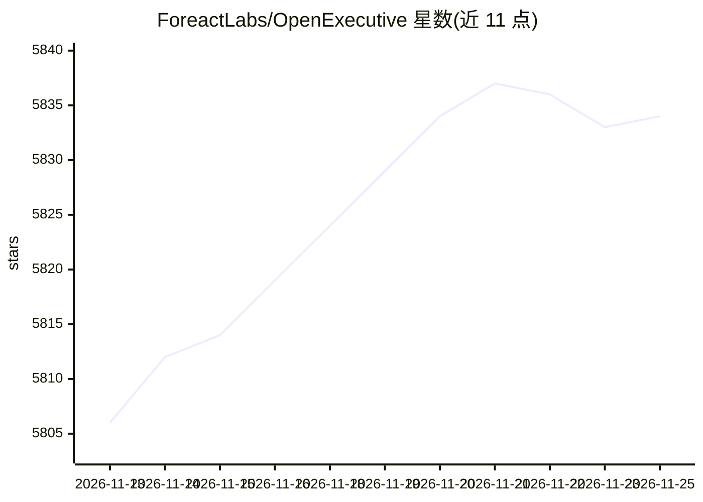

# ForeactLabs/OpenExecutive

⭐ 5,834 · Python · Apache-2.0 · 推送 2026-11-24 · [GitHub](https://github.com/ForeactLabs/OpenExecutive) · [官网](https://openexecutive.ai) · 组织维护

**开源 AI 虚拟高管团队：一个统一高管人设加多个专家 agent**

ForeAct Labs 开发的多 agent 虚拟高管系统：以一个统一的 Executive 人设面向用户，背后由 9 个专家 agent（战略、财务、人事、法务、运营、营销、产品、销售、董事会）与一个分诊 agent 组成，内部架构不暴露给用户。支持审批分级、以本人语气代拟邮件（As you）、以自身名义执行动作（As me）、浏览器扩展自动完成网页任务，并可接入 Slack/Discord/Telegram/Notion/Confluence/MCP 工具等。模型可自选：Claude、OpenRouter 各模型、Ollama/LM Studio/vLLM 等本地模型。限制：API 须单实例运行，调度器不可直接水平扩展；另预告托管云服务。技术栈为 FastAPI + Next.js，通过 git clone 与 make 运行。

## 筛选速览

| 维度 | 判定 | 备注 |
|---|---|---|
| AI 角色 | `ai-native` | 本体是模型或模型工具 |
| 许可风险 | `permissive` | Apache-2.0 |
| 部署形态 | `desktop` | 安装包/桌面程序 |
| 模型依赖 | local-ok | 支持本地模型 |
| 硬件要求 | — | 无带数字的原话,不猜 |
| 安装摩擦 | `low` | 无编译、无系统依赖或容器化 |
| 成熟度 | — | 结构信号不足 |

## 能力要点

- 单一高管人设背后由 9 个专家 agent 与分诊 agent 构成
- As you 以本人语气代拟邮件，Approvals 决定哪些动作可自主执行
- 双层知识检索（内置 MBA 级知识 + 上传公司文档，ChromaDB）与 SQLite 情景记忆
- 模型自选：Claude/OpenRouter/本地 Ollama、vLLM 等，可按 agent 混用

## 适用场景

- 让 AI 高管助手回答管理问题并跟踪决策与后续事项
- 用本人语气代拟邮件草稿，按审批规则决定是否自主发送
- 通过浏览器扩展让它在网页上代为完成表单填写等任务
- 接入 Slack/Notion/Confluence 等已有工作渠道协同办公

## 场景标签

`AI 助手` `多智能体` `RAG` · 领域:Agent 开发

## 证据(README 行号)

> L22: Developed by ForeAct Labs, Open Executive provides a single coherent executive voice backed by nine specialist AI a
> L36: All responses come from one consistent executive voice. The internal agent architecture is never exposed to the use
> L72: **Bring your own model.** Open Executive runs on Claude, on any model OpenRouter offers (GPT, Gemini, Llama, DeepSe

## 星数曲线

2026-11-13 5,806 → 2026-11-25 5,834（+28）

---
*卡片 v1 · prompt 1.4 · 生成 2026-11-17 · 置信度 high · 依据 README sha `426c46243ce8` · [字段定义](../../DATASET.md)*
