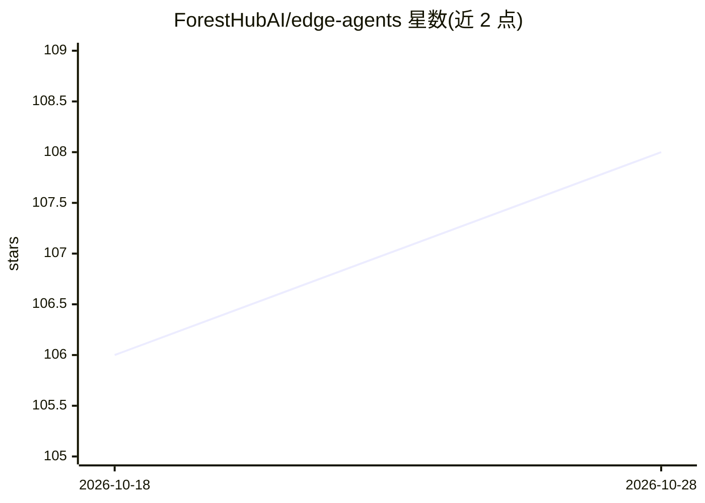

# ForestHubAI/edge-agents

⭐ 108 · TypeScript · AGPL-3.0 · 推送 2026-08-24 · [GitHub](https://github.com/ForestHubAI/edge-agents) · [官网](https://app.foresthub.ai) · 组织维护

**30 MB 级 Linux 边缘 AI agent 运行时，离线驱动 GPIO/MQTT 工作流**

面向 Linux 边缘设备（树莓派 5、Jetson Orin Nano、STM32MP25、ctrlX CORE）的 AI agent 运行时：引擎以约 30 MB 容器形式提供，运行类型化工作流图，节点覆盖 LLM 调用、GPIO/UART/ADC/PWM 硬件 I/O、MQTT、Web 搜索与控制流。支持 Anthropic/OpenAI/Gemini/Mistral 云端模型，本地 SLM 经 llama.cpp 单独容器接入。配套 fh-workflow CLI（npm 安装）提供可视化 React Flow 编辑、校验与部署捆绑生成，另提供 Claude Code 技能生成/部署工作流。OPC-UA、Modbus 与端侧 RAG 尚在路线图中。

## 筛选速览

| 维度 | 判定 | 备注 |
|---|---|---|
| AI 角色 | `ai-ecosystem` | LLM/agent 周边工具 |
| 许可风险 | `viral` | AGPL-3.0 |
| 部署形态 | `self-host` | docker 或自建部署 |
| 模型依赖 | local-ok | 支持本地模型 |
| 硬件要求 | — | 无带数字的原话,不猜 |
| 安装摩擦 | `low` | 无编译、无系统依赖或容器化 |
| 成熟度 | `idea` | |

## 能力要点

- 约 30 MB 引擎容器，默认离线运行、无控制平面与入站端口
- GPIO/UART/ADC/PWM/MQTT 为一等节点
- 多提供商 LLM 节点，本地 SLM 经 llama.cpp 独立容器接入
- fh-workflow CLI 提供可视化编辑、校验与自包含部署包生成

## 适用场景

- 在树莓派上离线跑唤醒词→STT→agent→TTS 语音助手
- 工业设备 MQTT 振动数据接入 LLM 做预测性维护告警
- 让 agent 直接读写传感器与继电器等硬件 I/O

## 场景标签

`工作流自动化` `Agent 框架` · 领域:Agent 开发

## 证据(README 行号)

> L3: **The 30 MB open-source edge AI agent runtime. Run AI agents offline, on Linux.**
> L188: - **Workflow engine** — typed graph runtime; nodes for LLM calls, hardware I/O, MQTT, web search, memory, control 
> L189: - **Multi-provider LLMs** — Anthropic, OpenAI, Google Gemini, Mistral, plus a local SLM provider for `llama.cpp` /

## 星数曲线

2026-10-18 106 → 2026-10-28 108（+2）

---
*卡片 v1 · prompt 1.4 · 生成 2026-10-23 · 置信度 high · 依据 README sha `cee53e63c973` · [字段定义](../../DATASET.md)*
