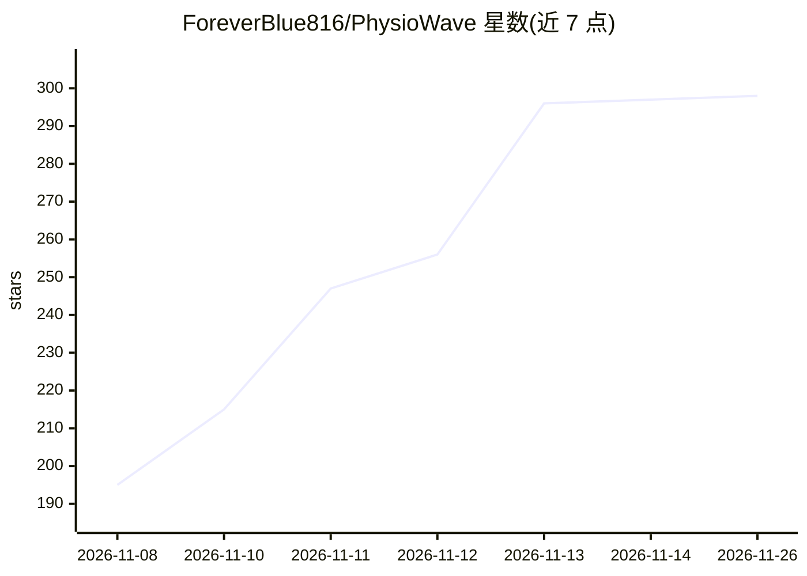

# ForeverBlue816/PhysioWave

⭐ 298 · Python · MIT · 推送 2026-11-10 · [GitHub](https://github.com/ForeverBlue816/PhysioWave) · [官网](https://huggingface.co/ForeverBlue) · 个人维护

**面向 EEG/ECG/sEMG 的小波基础模型与多模态融合代码库**

NeurIPS 2025 论文 PhysioWave-T 的官方实现：提供 EEG、ECG、sEMG 三种预训练编码器（权重托管在 Hugging Face Hub），支持任意通道数与采样率的输入布局，核心机制包括动态尺度折叠（ScaleFold）压缩 token 数、按采集配置划分的 route 前端、以及可靠性感知的 RALF 多模态潜在融合。面向需要在睡眠分期、心电分类、手势识别、癫痫检测等任务上微调生物信号模型的研究者。通过 git clone 源码 + conda/pip 安装，论文复现依赖 CINECA Leonardo 集群环境，各语料需自行按各自许可获取。

## 筛选速览

| 维度 | 判定 | 备注 |
|---|---|---|
| AI 角色 | `ai-native` | 本体是模型或模型工具 |
| 许可风险 | `permissive` | MIT |
| 部署形态 | `library` | 以包/库形式分发 |
| 模型依赖 | — | README 未给出锁定关系 |
| 硬件要求 | — | 无带数字的原话,不猜 |
| 安装摩擦 | `medium` | 含编译或系统依赖之一 |
| 成熟度 | — | 结构信号不足 |

## 能力要点

- 30M 参数 EEG 编码器在 19-128 通道、256/512 Hz 的 15.4M 窗口上预训练，不强制统一蒙太奇
- ScaleFold 将 token 序列从 (J+1)CS 缩至 CS，实测时延降 4.0-7.2 倍、峰值显存降 6.8-12.7 倍
- RALF 逐样本可靠性门控融合多模态，缺失模态可被遮蔽
- 编码器文件可加载到任意蒙太奇，未知通道名自动分配新嵌入行作为适配器

## 适用场景

- 在睡眠分期、P300、癫痫检测等 EEG 下游任务上微调预训练编码器
- ECG 多标签分类与 sEMG 手势识别的迁移学习
- 可穿戴设备上结合 EEG/ECG/EMG 做多模态癫痫检测
- 复现论文实验或继续预训练

## 场景标签

`多模态` `微调` · 领域:感知与多模态

## 证据(README 行号)

> L12: **Pretrained EEG, ECG and sEMG encoders that take any channel count and sampling rate,
> L13: and a reliability-aware fusion model that combines them.**
> L21: - **RALF.** Reliability-aware latent fusion combines the independently pretrained encoders with a per-sample reliab

## 星数曲线

2026-11-08 195 → 2026-11-26 298（+103）

---
*卡片 v1 · prompt 1.4 · 生成 2026-11-18 · 置信度 high · 依据 README sha `e5f8c6072260` · [字段定义](../../DATASET.md)*
