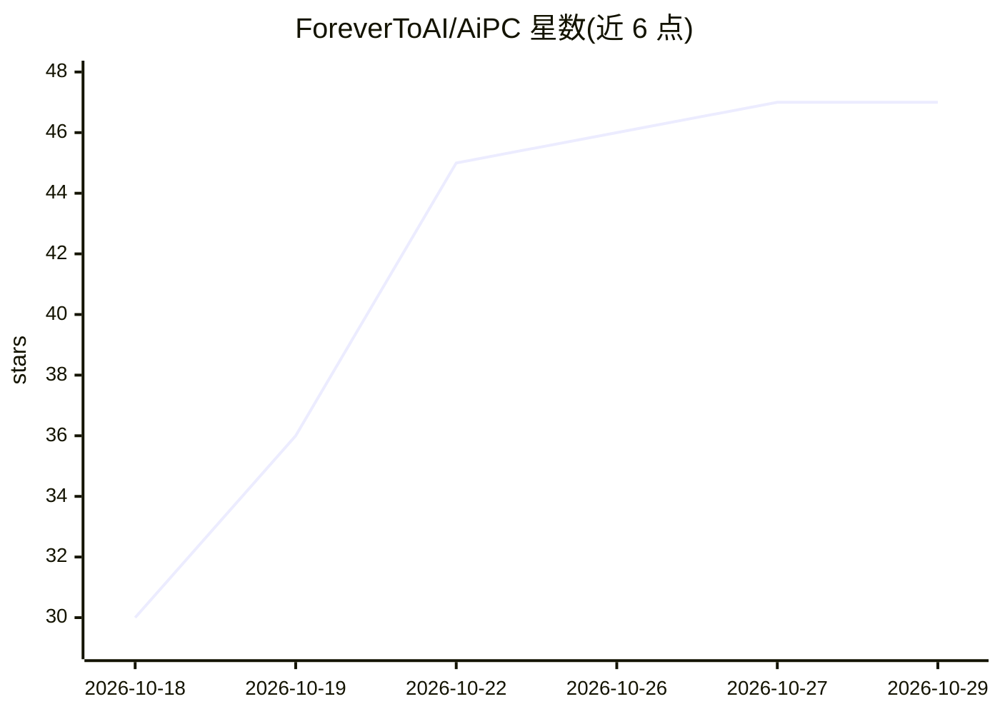

# ForeverToAI/AiPC

⭐ 47 · Python · MIT · 推送 2026-10-07 · [GitHub](https://github.com/ForeverToAI/AiPC) · [官网](https://aipc.sysik.mom) · 个人维护

**让 AI agent 通过 MCP 获得真实 PC 控制能力的本地服务**

AiPC 是本地服务加控制台工具，通过 MCP（Model Context Protocol）标准向任意 AI agent 提供对计算机的访问：屏幕截图、鼠标键盘操作、浏览器（CDP）、文件系统、终端、SSH/SFTP 等 70 个工具，覆盖 19 个 IDE 家族的 MCP 注册。安全机制包括默认 ask 模式（危险操作弹出 Yes/No 对话框由人确认）、read-only 服务端阻断、工具风险分级、命令与路径 deny-list、紧急停止键。面向在自己机器上做个人自动化与测试的用户，Windows 提供安装包，macOS/Linux 提供二进制或 pip/npm 源码安装。

## 筛选速览

| 维度 | 判定 | 备注 |
|---|---|---|
| AI 角色 | `ai-ecosystem` | LLM/agent 周边工具 |
| 许可风险 | `permissive` | MIT |
| 部署形态 | `desktop` | 安装包/桌面程序 |
| 模型依赖 | — | README 未给出锁定关系 |
| 硬件要求 | — | 无带数字的原话,不猜 |
| 安装摩擦 | `low` | 无编译、无系统依赖或容器化 |
| 成熟度 | — | 结构信号不足 |

## 能力要点

- 70 个 MCP 工具：视觉、鼠标键盘、浏览器 CDP、文件、终端、SSH/SFTP、音频、视频
- 默认 ask 模式：危险操作弹窗由人确认，另有 auto 与服务端阻断的 read-only 模式
- 截图以原生 MCP 图像块传输（约 65 字符 JSON + 图像），支持 minimal/browser/full 三档工具配置
- 19 个配置覆盖 14 个 IDE 家族的 MCP 自动注册，含云端 IDE Bridge 方案

## 适用场景

- 让 IDE 中的 agent 在我本机执行看屏、点击、输字、跑命令、SSH 取日志等任务
- 为不具备计算机访问能力的模型接入真实 PC 操作
- 在本机做需要 GUI 验证的自动化与测试任务

## 场景标签

`GUI 自动化` `浏览器自动化` · 领域:效率与自动化

## 证据(README 行号)

> L26: **AiPC** is a local service + console utility that gives any AI agent full access
> L30: [ Agent in any IDE ] --MCP/stdio--> [ AiPC-Core: one local service ]

## 星数曲线

2026-10-18 30 → 2026-10-29 47（+17）

---
*卡片 v1 · prompt 1.4 · 生成 2026-10-25 · 置信度 high · 依据 README sha `a1cff93122b8` · [字段定义](../../DATASET.md)*
