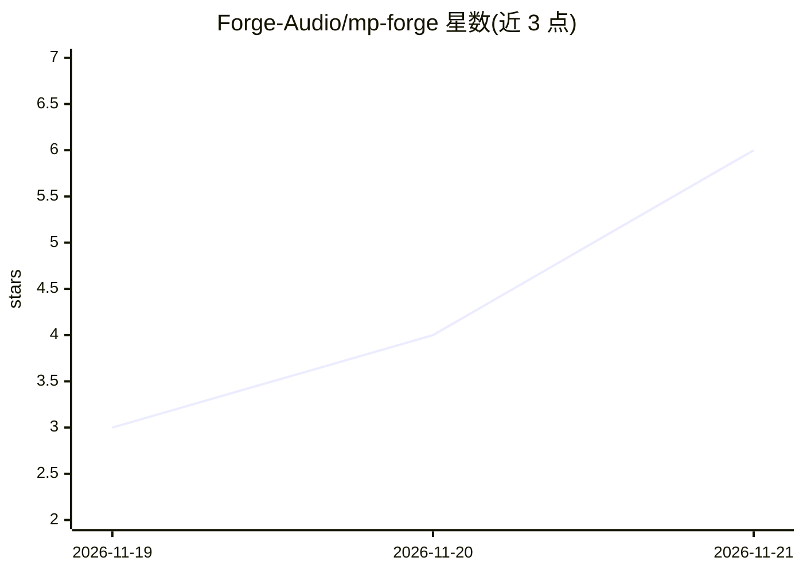

# Forge-Audio/mp-forge

⭐ 6 · Rust · GPL-3.0 · 推送 2026-11-20 · [GitHub](https://github.com/Forge-Audio/mp-forge) · [官网](https://forge-audio.github.io/mp-forge/) · 组织维护

**为 Akai MPC 生成乐器/效果器插件的桌面 AI 工具**

面向 Akai MPC 硬件的免费开源桌面应用：用户用自然语言描述想要的乐器或效果器，由自选 AI 调用 Akai 官方 Plugin SDK 编写插件，应用负责编译、运行十二项安全检查、在电脑上试听试玩，再经 USB/SD 卡发送到 MPC。无需写代码或安装构建工具。也支持从 Open MPC 目录混改现成插件、手动编辑界面控件、导出单文件分享。要求 MPC 运行 OS 3.10.1+ 并开启 External Plugin Support。

## 筛选速览

| 维度 | 判定 | 备注 |
|---|---|---|
| AI 角色 | `ai-enhanced` | 去掉 AI 部分产品仍成立 |
| 许可风险 | `viral` | GPL-3.0 |
| 部署形态 | `library` | 以包/库形式分发 |
| 模型依赖 | local-ok | 支持本地模型 |
| 硬件要求 | — | 无带数字的原话,不猜 |
| 安装摩擦 | `low` | 无编译、无系统依赖或容器化 |
| 成熟度 | `idea` | |

## 能力要点

- 自然语言描述生成插件，基于 Akai 官方 MPC Plugin SDK
- 支持 Claude/ChatGPT/OpenAI/Google/xAI/Mistral/DeepSeek/OpenRouter 及本地 Ollama
- 十二项安全检查未通过则不允许发送到 MPC
- 每次修改前保留版本，可回退到任意历史版本

## 适用场景

- 为我的 MPC 快速做出自定义乐器和效果器
- 不用写代码、不装构建工具就能玩插件开发
- 从现有开源插件混改出属于自己的版本
- 把做好的插件导出成文件分享给其他乐手

## 场景标签

`代码生成` · 领域:编码与开发

## 证据(README 行号)

> L6:  A free, open-source desktop app for Akai MPC hardware.
> L17: idea, remix an open plugin, or press I'M FEELING LUCKY, and an AI of your choice builds it with Akai's own MPC
> L21: MP Forge runs twelve safety checks on it, then sends it to your MPC. There is no code to write and no build

## 星数曲线

2026-11-19 3 → 2026-11-21 6（+3）

---
*卡片 v1 · prompt 1.4 · 生成 2026-11-21 · 置信度 mid · 依据 README sha `fa25cd676cbe` · [字段定义](../../DATASET.md)*
