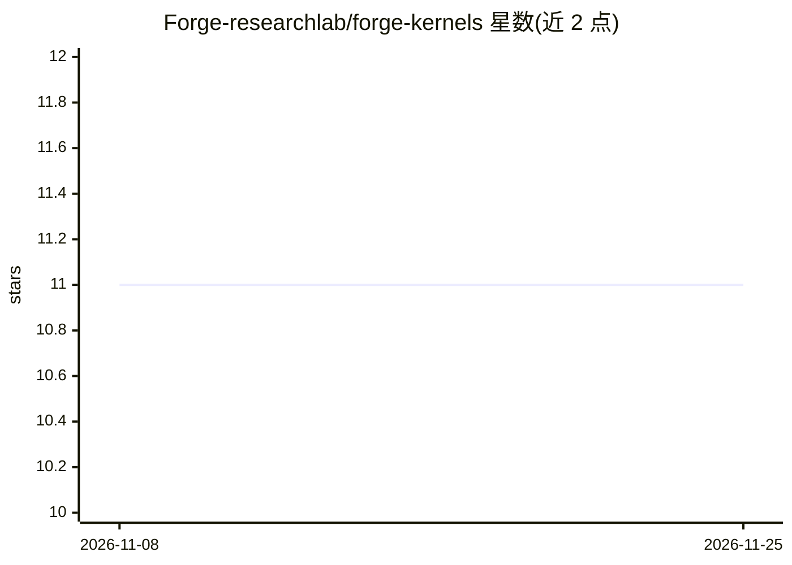

# Forge-researchlab/forge-kernels

⭐ 11 · Python · Apache-2.0 · 推送 2026-08-15 · [GitHub](https://github.com/Forge-researchlab/forge-kernels) · 组织维护

**LLM 微调的融合 Triton 算子库：一次 patch 接入 HF 模型**

面向 Hugging Face 模型的融合 Triton 算子集合，通过 forge.patch(model) 一行调用替换模型中的 RMSNorm、RoPE、SwiGLU/GeGLU、Embedding、LoRA QKV/MLP、融合线性交叉熵等前向实现，带幂等 unpatch 与按 shape 回退原实现的保护机制。支持 Qwen2/2.5/3 与 Gemma/Gemma2，patched 前向在 FSDP2 分片 DTensor 下保持可用。要求 CUDA GPU（Python 3.11–3.12、CUDA 12.1+、torch 2.4.x、triton 3.0.x），从 GitHub 源码 pip 安装；每项加速数据对应仓库内已提交的结果文件，文档同时列出各算子的性能回退场景。

## 筛选速览

| 维度 | 判定 | 备注 |
|---|---|---|
| AI 角色 | `ai-ecosystem` | LLM/agent 周边工具 |
| 许可风险 | `permissive` | Apache-2.0 |
| 部署形态 | `library` | 以包/库形式分发 |
| 模型依赖 | — | README 未给出锁定关系 |
| 硬件要求 | — | 无带数字的原话,不猜 |
| 安装摩擦 | `medium` | 含编译或系统依赖之一 |
| 成熟度 | — | 结构信号不足 |

## 能力要点

- forge.patch(model) 一行替换内核，幂等 unpatch，无需改训练器
- shape guard：形状过小时自动回退原前向
- FSDP2 兼容：分片 DTensor 下前向保持正确（兼容而非分布式加速）
- 每项加速对应已提交的 CSV/JSON 结果文件

## 适用场景

- 为 Qwen/Gemma 系列微调加速并降低显存占用
- 在 Hugging Face 训练流程中按 shape 自动启用融合算子
- 复现基准测试并查看每个算子的性能回退清单

## 场景标签

`微调` · 领域:训练与推理

## 证据(README 行号)

> L3: Fused Triton kernels for LLM fine-tuning, with a one-call patching layer for
> L13: - **One-call patching.** `forge.patch(model)` swaps the kernels into a live model in place, with an idempotent `unp
> L25: Requires a CUDA GPU. Python 3.11–3.12, CUDA 12.1+, `torch>=2.4,<2.5`,

## 星数曲线

2026-11-08 11 → 2026-11-25 11（+0）

---
*卡片 v1 · prompt 1.4 · 生成 2026-11-19 · 置信度 high · 依据 README sha `3a129613d90b` · [字段定义](../../DATASET.md)*
