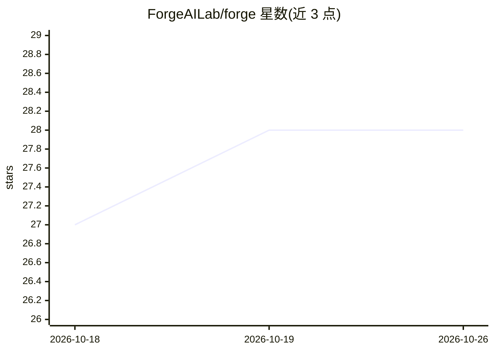

# ForgeAILab/forge

⭐ 28 · Rust · MIT · 推送 2026-10-25 · [GitHub](https://github.com/ForgeAILab/forge) · [官网](https://forgeailab.github.io/) · 组织维护

**自托管控制平面：多 coding agent 在同一仓库协作与任务治理**

Rust 编写的本地优先自托管控制平面，用于编排多个 AI coding agent 在同一仓库协作：独立 Task 获得隔离 git worktree，有序子任务在共享 worktree 串行执行，每个 Task 经过 CI 门与审查后才合入 main。提供主 Agent 聊天、Project Agent、结构化任务生命周期（todo→done）、审计日志，以及 REST、MCP、CLI 和 React Web UI，全部打包为单一二进制。BYO agent 适配器支持 Claude Code、Codex、Cursor、Gemini 等。当前为 public beta（0.1.x），API 与 schema 可能无弃用周期地变更。

## 筛选速览

| 维度 | 判定 | 备注 |
|---|---|---|
| AI 角色 | `ai-ecosystem` | LLM/agent 周边工具 |
| 许可风险 | `permissive` | MIT |
| 部署形态 | `library` | 以包/库形式分发 |
| 模型依赖 | — | README 未给出锁定关系 |
| 硬件要求 | — | 无带数字的原话,不猜 |
| 安装摩擦 | `low` | 无编译、无系统依赖或容器化 |
| 成熟度 | `idea` | |

## 能力要点

- 独立 Task 隔离 git worktree，有序子任务共享 worktree 串行执行
- 结构化任务生命周期（todo→in_progress→review→merging→done）与 CI 门/审查门
- BYO agent 适配器：Claude Code、Codex、Cursor、Gemini、opencode、Smith 及通用 shell
- 单一二进制内含 REST、MCP、CLI、Web UI；SQLite 存储，无遥测

## 适用场景

- 多个 coding agent 同时跑一个仓库时避免分支冲突与丢失 diff
- 小团队试点 agent 工作流，需要 worktree 隔离与审计记录
- 在代码合入 main 前强制 CI 与审查门

## 场景标签

`编码 Agent` `多智能体` · 领域:Agent 开发

## 证据(README 行号)

> L11: Forge hosts durable embedded assistants and task-scoped coding agents in one
> L35: - **BYO agent** — first-class adapters for Claude Code, Codex, Cursor, Gemini, opencode, Smith, and a generic shell

## 星数曲线

2026-10-18 27 → 2026-10-26 28（+1）

---
*卡片 v1 · prompt 1.4 · 生成 2026-10-26 · 置信度 high · 依据 README sha `2fb5f77a059b` · [字段定义](../../DATASET.md)*
