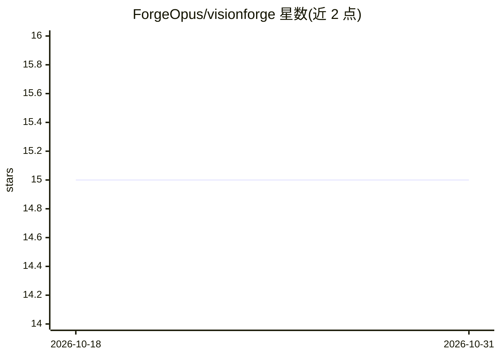

# ForgeOpus/visionforge

⭐ 15 · TypeScript · BSD-3-Clause · 推送 2026-04-28 · [GitHub](https://github.com/ForgeOpus/visionforge) · [官网](https://visionforge.forgeopus.org) · 个人维护

**拖拽式可视化神经网络搭建器，导出 PyTorch/TensorFlow 代码**

面向研究者、学生和 ML 工程师的可视化神经网络构建工具：通过拖拽图层块（Conv/LSTM/BatchNorm 等）设计架构，自动推断张量形状，实时校验后一键导出 PyTorch 或 TensorFlow 代码。内置基于 Google Gemini API 的自然语言助手，可提问或修改模型。技术栈为 React 19 前端 + Django 后端 + SQLite，需 Python 3.8+、Node.js 16+ 与 Gemini API key（用于 AI 助手），从源码分别启动前后端。

## 筛选速览

| 维度 | 判定 | 备注 |
|---|---|---|
| AI 角色 | `ai-ecosystem` | LLM/agent 周边工具 |
| 许可风险 | `permissive` | BSD-3-Clause |
| 部署形态 | `library` | 以包/库形式分发 |
| 模型依赖 | — | README 未给出锁定关系 |
| 硬件要求 | — | 无带数字的原话,不猜 |
| 安装摩擦 | `low` | 无编译、无系统依赖或容器化 |
| 成熟度 | — | 结构信号不足 |

## 能力要点

- 拖拽搭建 CNN/LSTM/ResNet 等架构，含 20 余种图层类型
- 自动张量形状推断，无需手动跟踪维度
- 一键导出 PyTorch 或 TensorFlow 代码
- Gemini 自然语言助手与导出前实时架构校验

## 适用场景

- 不写代码快速原型化深度学习架构
- 教学场景中演示 CNN/LSTM 等网络结构
- 把可视化设计的模型导出为可生产的框架代码

## 场景标签

`代码生成` · 领域:编码与开发

## 证据(README 行号)

> L24: VisionForge is a **visual neural network builder** that lets you design complex deep learning architectures without
> L77: 5. **Export** production-ready code for PyTorch or TensorFlow

## 星数曲线

2026-10-18 15 → 2026-10-31 15（+0）

---
*卡片 v1 · prompt 1.4 · 生成 2026-10-30 · 置信度 mid · 依据 README sha `2f94cb2dacd5` · [字段定义](../../DATASET.md)*
