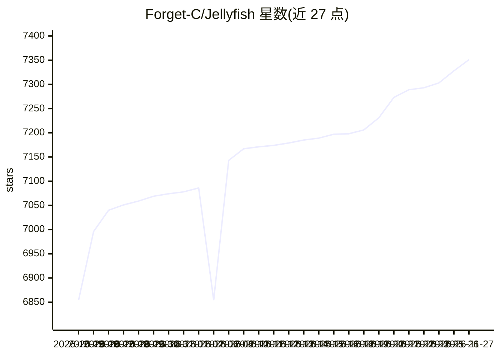

# Forget-C/Jellyfish

⭐ 7,351 · Python · Apache-2.0 · 推送 2026-11-25 · [GitHub](https://github.com/Forget-C/Jellyfish) · [官网](https://www.jellyfishai.cc/) · 个人维护 · 中文 README

**面向短剧团队的 AI 分镜与视频生成工作台**

以 React+Vite 前端与 FastAPI 后端构成的项目式工作区：将章节文本拆解为场景与分镜，在画布上把镜头描述与角色/场景/道具参考图连接到图像或视频模型，生成候选帧与媒体供创作者挑选。通过项目资产实现角色、场景、道具的一致性复用，内置异步任务中心追踪文本/图像/视频作业，支持配置模型提供商与提示词模板。界面默认中文并支持英文。部署依赖 Docker Compose（含 MySQL 与 RustFS），生成媒体前需先配置模型。

## 筛选速览

| 维度 | 判定 | 备注 |
|---|---|---|
| AI 角色 | `ai-native` | 本体是模型或模型工具 |
| 许可风险 | `permissive` | Apache-2.0 |
| 部署形态 | `self-host` | docker 或自建部署 |
| 模型依赖 | — | README 未给出锁定关系 |
| 硬件要求 | — | 无带数字的原话,不猜 |
| 安装摩擦 | `low` | 无编译、无系统依赖或容器化 |
| 成熟度 | — | 结构信号不足 |

## 能力要点

- 章节→场景→分镜的拆解与画布编辑工作流
- 角色/场景/道具资产引用，跨镜头保持一致性
- 统一异步任务中心，追踪文本、图像、视频作业
- 模型提供商与提示词模板的可配置基础设施

## 适用场景

- 短剧团队协作准备分镜并评审候选帧
- 独立创作者为同一场景尝试不同镜头方案
- 教育、品牌与电商团队将剧本发展为短视频

## 场景标签

`视频生成` `图像生成` · 领域:内容生成

## 证据(README 行号)

> L25: A production workspace for AI short dramas. Divide a chapter into scenes, prepare visual references and generate ca
> L69: On the canvas, connect shot descriptions and references to a model card, check its inputs and review the generated 

## 星数曲线

2026-10-25 6,854 → 2026-11-27 7,351（+497）

---
*卡片 v1 · prompt 1.4 · 生成 2026-11-24 · 置信度 high · 依据 README sha `22d11ea970ab` · [字段定义](../../DATASET.md)*
