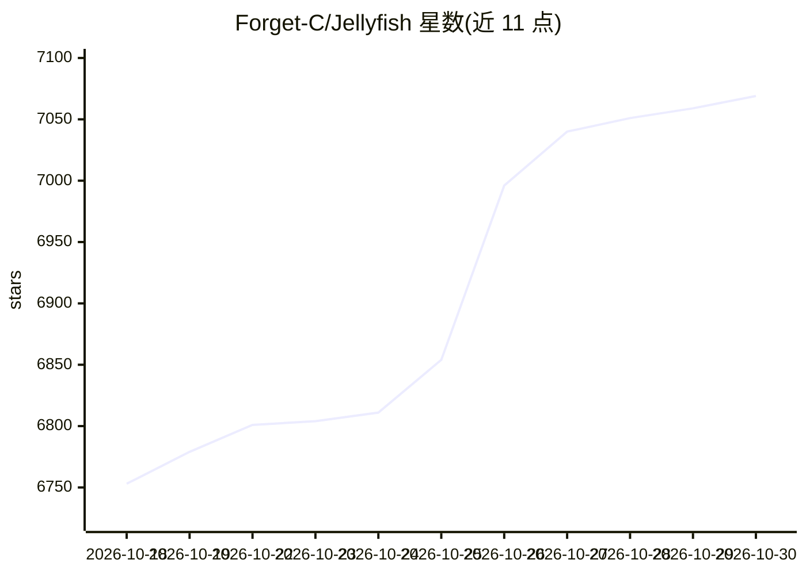

# Forget-C/Jellyfish

⭐ 7,069 · Python · Apache-2.0 · 推送 2026-07-30 · [GitHub](https://github.com/Forget-C/Jellyfish) · [官网](https://forget-c.github.io/Jellyfish) · 个人维护 · 中文 README

**AI 短剧端到端生产工作台：从剧本到视频生成与导出**

面向短剧/微短剧创作者的 AI 视频生产工作台：读取章节剧本后自动拆分镜头、抽取角色/场景/道具/服装与对白，提供候选确认与镜头就绪度判定；通过多 provider/多模型管理调度文本、图像与视频生成任务，统一异步任务中心支持状态跟踪、取消与上下文跳转；集中实体管理与提示词模板用于跨镜头一致性。前端 React+Vite、后端 FastAPI，提供 Docker Compose 部署（含 MySQL/Redis/RustFS），也支持本地 uv/pnpm 开发运行。Apache-2.0 许可。

## 筛选速览

| 维度 | 判定 | 备注 |
|---|---|---|
| AI 角色 | `ai-native` | 本体是模型或模型工具 |
| 许可风险 | `permissive` | Apache-2.0 |
| 部署形态 | `self-host` | docker 或自建部署 |
| 模型依赖 | — | README 未给出锁定关系 |
| 硬件要求 | — | 无带数字的原话,不猜 |
| 安装摩擦 | `low` | 无编译、无系统依赖或容器化 |
| 成熟度 | — | 结构信号不足 |

## 能力要点

- 剧本→分镜→候选确认→生成工作区的结构化流水线
- 集中管理角色/场景/道具/服装实体以控制跨镜头一致性
- 统一异步任务中心：状态/耗时跟踪、取消、恢复导航
- 多 provider/多模型管理与提示词模板基础设施

## 适用场景

- 短剧/微短剧团队从剧本批量生成视频内容
- 个人创作者探索竖屏短剧生产流程
- 教育或电商团队制作叙事型宣传视频

## 场景标签

`视频生成` · 领域:内容生成

## 证据(README 行号)

> L24: An end-to-end production workspace for AI-generated short dramas.
> L36: - **Connect the full production flow**: Move from script input to storyboard preparation, image/video generation, a
> L110: - multi-provider / multi-model management

## 星数曲线

2026-10-18 6,753 → 2026-10-30 7,069（+316）

---
*卡片 v1 · prompt 1.4 · 生成 2026-10-20 · 置信度 mid · 依据 README sha `07735e2cc90c` · [字段定义](../../DATASET.md)*
