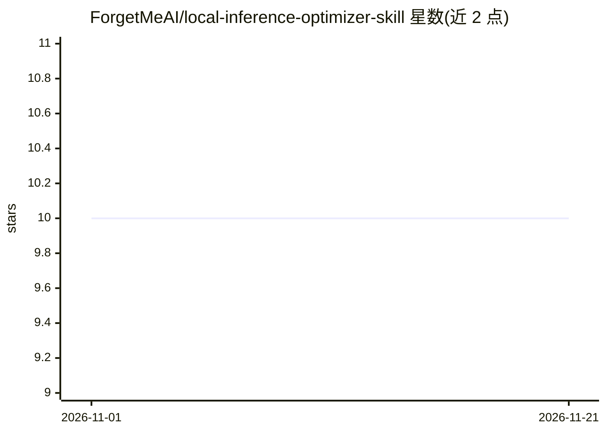

# ForgetMeAI/local-inference-optimizer-skill

⭐ 10 · Python · MIT · 推送 2026-06-28 · [GitHub](https://github.com/ForgetMeAI/local-inference-optimizer-skill) · 组织维护

**为 AI 代理提供技能：按硬件与负载选择并配置本地 LLM 推理引擎**

面向 Hermes / Claude Code / Codex 类代理的 skill 包：代理先检查真实硬件（Apple Silicon、NVIDIA CUDA、AMD ROCm、Intel、CPU-only），再按引擎选择表挑选 MLX、llama.cpp、ExLlama、vLLM、SGLang、TensorRT-LLM 或 OpenVINO/ONNX Runtime，创建 uv + .venv 项目，调整 kernels、量化、context、batching、KV cache、prefix cache、tensor parallel 等参数，并通过 health check 与 OpenAI-compatible smoke test 验证服务。提供 install.sh 一键安装到 Hermes，可导出 AGENTS.md / CLAUDE.md 供其他代理使用，文档含俄/英/中三语。

## 筛选速览

| 维度 | 判定 | 备注 |
|---|---|---|
| AI 角色 | `ai-ecosystem` | LLM/agent 周边工具 |
| 许可风险 | `permissive` | MIT |
| 部署形态 | `None` |  |
| 模型依赖 | local-ok | 支持本地模型 |
| 硬件要求 | — | 无带数字的原话,不猜 |
| 安装摩擦 | `medium` | 含编译或系统依赖之一 |
| 成熟度 | — | 结构信号不足 |

## 能力要点

- 按硬件/场景映射推理引擎的选择表（MLX/llama.cpp/ExLlama/vLLM/SGLang/TensorRT-LLM 等）
- 自动创建 uv + .venv 项目并调整量化、batching、KV cache、tensor parallel 等参数
- health check + OpenAI-compatible smoke test 验证运行
- 可导出 AGENTS.md / CLAUDE.md 兼容 Claude Code 与 Codex 类代理

## 适用场景

- 让代理根据我的 GPU/CPU 环境自动选型并部署本地推理服务
- 为生产 OpenAI-compatible API 搭建 vLLM 推理栈
- 在多 GPU 机器上配置长上下文 / MoE 模型的推理方案

## 场景标签

`推理引擎` · 领域:训练与推理

## 证据(README 行号)

> L13: **Local Inference Optimizer** — skill для Hermes / Claude Code / Codex-агентов, который помогает агенту не гадать, 
> L18: - выбрать inference engine: MLX, llama.cpp, ExLlama, vLLM, SGLang, TensorRT-LLM, OpenVINO/ONNX Runtime;
> L109: **Local Inference Optimizer** is a skill for Hermes / Claude Code / Codex-style agents. It helps the agent inspect

## 星数曲线

2026-11-01 10 → 2026-11-21 10（+0）

---
*卡片 v1 · prompt 1.4 · 生成 2026-11-20 · 置信度 high · 依据 README sha `92caf48c4a75` · [字段定义](../../DATASET.md)*
