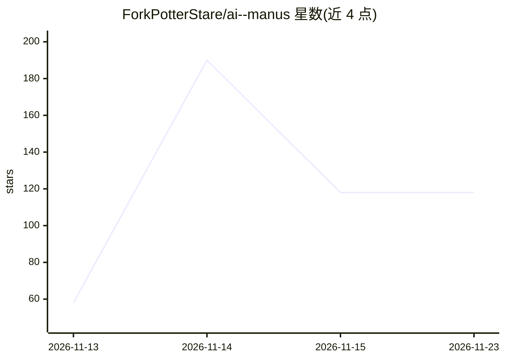

# ForkPotterStare/ai--manus

⭐ 118 · Apache-2.0 · 推送 2026-11-15 · [GitHub](https://github.com/ForkPotterStare/ai--manus) · 个人维护

**面向个人用户的自主 AI Agent：代跑代码与操作浏览器**

README 描述的 Manus 是一个自主 AI Agent，用户以自然语言下达指令后，Agent 自主编写并执行脚本、控制浏览器（导航、填表、采集信息），并可跨脚本与浏览器组合完成多步骤任务，主要面向家庭、学习与轻办公场景的非开发者。仓库主题标签提及 OpenAI、Anthropic、Gemini、React 等。README 未提供任何安装命令、源码结构或技术实现细节，仅含功能宣传文案、一份硬件兼容表（最低 4GB 内存）与通用使用步骤，实际交付物无法从 README 核实。

## 筛选速览

| 维度 | 判定 | 备注 |
|---|---|---|
| AI 角色 | `ai-native` | 本体是模型或模型工具 |
| 许可风险 | `permissive` | Apache-2.0 |
| 部署形态 | `None` |  |
| 模型依赖 | — | README 未给出锁定关系 |
| 硬件要求 | — | 无带数字的原话,不猜 |
| 安装摩擦 | `low` | 无编译、无系统依赖或容器化 |
| 成熟度 | — | 结构信号不足 |

## 能力要点

- 自主编写并执行代码完成任务
- 浏览器控制：导航网页、填写表单、采集信息
- 脚本与浏览器操作可在同一任务流中衔接
- 提供硬件兼容表（最低双核 CPU、4GB 内存）

## 适用场景

- 让学生整理研究资料、跑小型计算脚本
- 让 Agent 代替人工浏览多个页面并汇总信息
- 远程工作者用浏览器控制采集数据

## 场景标签

`编码 Agent` `浏览器自动化` `AI 助手` · 领域:效率与自动化

## 证据(README 行号)

> L10: - **Autonomous Code Execution:** Manus AI agent runs code on its own to complete tasks, so you can focus on decisio
> L18: Manus is an autonomous AI agent designed to run code and control a browser on your behalf. Instead of acting like a

## 星数曲线

2026-11-13 58 → 2026-11-23 118（+60）

---
*卡片 v1 · prompt 1.4 · 生成 2026-11-17 · 置信度 low · 依据 README sha `0f78ee3a5dd2` · [字段定义](../../DATASET.md)*
