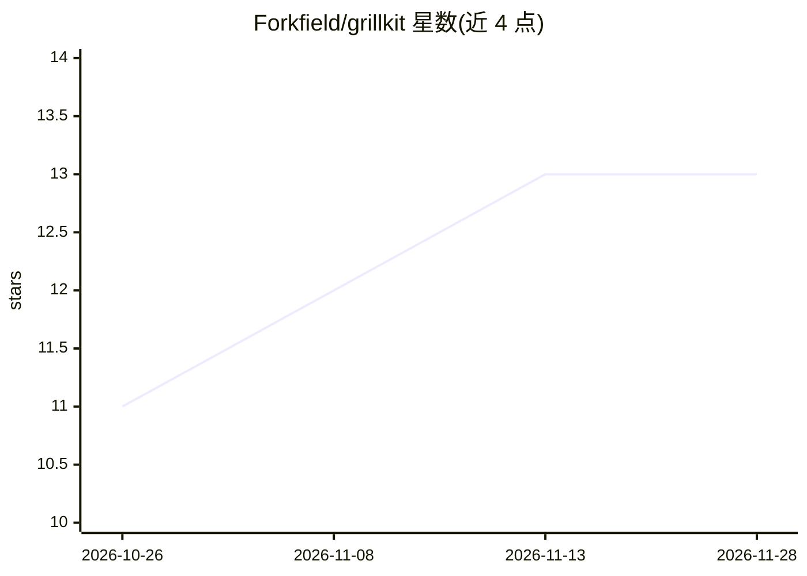

# Forkfield/grillkit

⭐ 13 · Python · NOASSERTION · 推送 2026-11-24 · [GitHub](https://github.com/Forkfield/grillkit) · 个人维护

**自托管 AI 技术面试训练器：语音作答与实时评分**

面向求职者的技术面试训练器：从 YAML 题库（Python、Kafka、系统设计等）生成结构化面试会话，覆盖理论问答、编程题或两者组合，提供 1–5 分 AI 评分、每题最多 2 个追问、Monaco 编辑器编码练习（需 Judge0）、离线 Whisper 语音听写与可选 Piper 朗读。数据自托管于本地 SQLite，支持 Docker Compose 部署，模型接入任意 OpenAI 兼容 API（云端或本地），API key 与历史留在本机。

## 筛选速览

| 维度 | 判定 | 备注 |
|---|---|---|
| AI 角色 | `ai-native` | 本体是模型或模型工具 |
| 许可风险 | `permissive` | NOASSERTION |
| 部署形态 | `self-host` | docker 或自建部署 |
| 模型依赖 | local-ok | 支持本地模型 |
| 硬件要求 | — | 无带数字的原话,不猜 |
| 安装摩擦 | `low` | 无编译、无系统依赖或容器化 |
| 成熟度 | — | 结构信号不足 |

## 能力要点

- 理论问答与编程题双模式会话，AI 评分 1–5 分并支持追问
- 离线 Whisper 听写、可选 Piper TTS 朗读、支持音频作答
- 编码练习基于 Monaco 编辑器，Run/Submit 分别跑公开与隐藏测试（需 Judge0）
- 本地 Dashboard 记录历史会话与逐题回顾页面

## 适用场景

- 求职前按技术栈和级别进行结构化模拟面试
- 用语音作答练习口头表达技术问题
- 在本地部署中练习编码题并获得 AI 反馈
- 标记已掌握题目并在后续会话中排除

## 场景标签

`AI 助手` · 领域:对话与助手

## 证据(README 行号)

> L7: Open-source AI technical interview trainer. Practice **theory Q&A**, **live coding**, or **both in one session** fro
> L24: |Where data lives|Vendor cloud|**Self-hosted**: SQLite + `data/` on your machine; use **Ollama**, vLLM, or any Open

## 星数曲线

2026-10-26 11 → 2026-11-28 13（+2）

---
*卡片 v1 · prompt 1.4 · 生成 2026-11-18 · 置信度 high · 依据 README sha `2fb774871695` · [字段定义](../../DATASET.md)*
