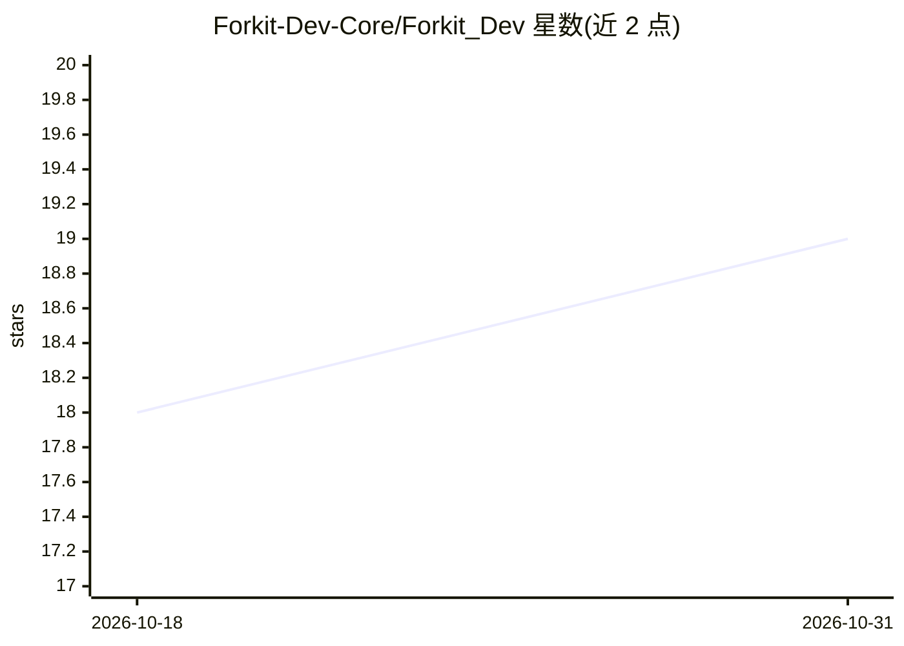

# Forkit-Dev-Core/Forkit_Dev

⭐ 19 · Python · NOASSERTION · 推送 2026-09-15 · [GitHub](https://github.com/Forkit-Dev-Core/Forkit_Dev) · 组织维护

**给 AI 模型与 agent 建立可移植确定性身份护照的开源库**

为 AI 模型和 agent 提供本地优先的身份层：以稳定字段派生确定性的 passport_id（SHA-256），护照文档携带来源链接、artifact 哈希与 lineage 记录（覆盖基座模型、微调与 fork）。提供 Python SDK、CLI、本地 JSON 注册表（可重建 SQLite 索引）、本地 HTTP 服务、GitHub CI 校验路径，以及 LangGraph/LangChain/OpenClaw 适配器和 Hugging Face 模型卡导出。声明为 Alpha 阶段，PyPI 尚未上线，需从 GitHub 仓库安装；不声称模型安全合规，也不替代 model cards/SBOM/证明。

## 筛选速览

| 维度 | 判定 | 备注 |
|---|---|---|
| AI 角色 | `ai-ecosystem` | LLM/agent 周边工具 |
| 许可风险 | `none` | NOASSERTION |
| 部署形态 | `library` | 以包/库形式分发 |
| 模型依赖 | — | README 未给出锁定关系 |
| 硬件要求 | — | 无带数字的原话,不猜 |
| 安装摩擦 | `low` | 无编译、无系统依赖或容器化 |
| 成熟度 | `idea` | |

## 能力要点

- 确定性 passport_id：相同输入派生相同 ID，变更 artifact 或 creator 则改变
- 护照含 provenance 链接、artifact 哈希与 lineage（parent_hash 哈希链）
- GitHub CI 校验已提交护照文件的 schema 与确定性 ID 一致性
- 提供 SDK/CLI/本地服务/同步原语与 LangChain、LangGraph、OpenClaw 适配器

## 适用场景

- 为跨仓库、跨团队流转的模型和 agent 维持稳定身份
- 在 CI 中自动校验模型护照的完整性与确定性 ID
- 记录微调与 fork 的 lineage 供治理流程接入

## 场景标签

`MLOps` · 领域:训练与推理

## 证据(README 行号)

> L5: Portable passports for AI models and agents: deterministic IDs, provenance links, artifact hashes, lineage records, 
> L39: AI models and agents often move across repos, tools, teams, and runtimes without stable identity, lineage, or verif
> L88: - a deterministic identity contract for AI models and agents

## 星数曲线

2026-10-18 18 → 2026-10-31 19（+1）

---
*卡片 v1 · prompt 1.4 · 生成 2026-10-29 · 置信度 mid · 依据 README sha `a7671bcea9a6` · [字段定义](../../DATASET.md)*
