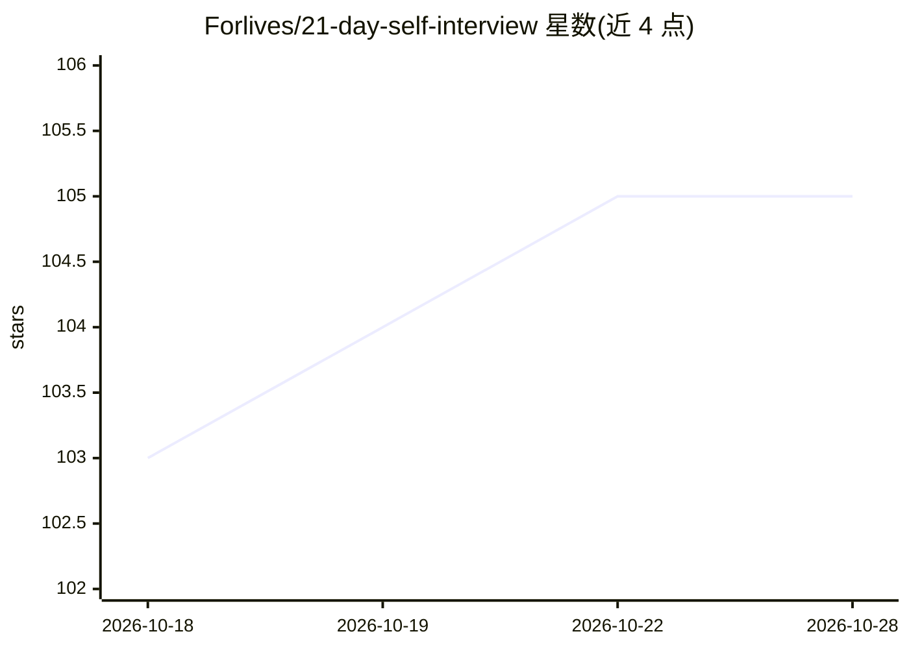

# Forlives/21-day-self-interview

⭐ 105 · Python · MIT · 推送 2026-06-08 · [GitHub](https://github.com/Forlives/21-day-self-interview) · 个人维护 · 中文 README

**AI 存在主义心理咨询师技能：21 晚每晚三问并记忆回映**

一个 Hermes Agent 技能，让 AI 扮演存在主义心理咨询师：连续 21 个夜晚每晚提出三个层层递进的问题，记录每个回答，并在第 7、14、21 天将用户过去的原话编织成画像回映。流程分「看见→理解→选择」三阶段，题库为纯 JSON（中英双语），可编辑问题或 fork 成 7/30 天版本。核心脚本 si.py 仅用 Python 标准库，无第三方依赖，通过每晚定时任务运行。README 声明这是镜子而非医生，危机情况应寻求人类专业帮助。

## 筛选速览

| 维度 | 判定 | 备注 |
|---|---|---|
| AI 角色 | `ai-native` | 本体是模型或模型工具 |
| 许可风险 | `permissive` | MIT |
| 部署形态 | `None` |  |
| 模型依赖 | — | README 未给出锁定关系 |
| 硬件要求 | — | 无带数字的原话,不猜 |
| 安装摩擦 | `low` | 无编译、无系统依赖或容器化 |
| 成熟度 | — | 结构信号不足 |

## 能力要点

- 21 晚三阶段递进题库（看见/理解/选择），借鉴 Yalom、Frankl 等存在主义心理学
- 记忆用户回答，第 7、14、21 天把原话拼成画像回映
- si.py 纯 Python 标准库实现，零第三方依赖
- 中英双语题库（questions.zh.json / questions.en.json），可 fork 变体

## 适用场景

- 让 AI agent 每晚定时带我做 21 天自我访谈
- 通过回映日看到自己过去说过的话组成的自画像
- 编辑题库或 fork 成 7 天/30 天版本做自我反思练习

## 场景标签

`AI 助手` `Agent 记忆` · 领域:Agent 开发

## 证据(README 行号)

> L25: 「21 天自我访谈」不一样。它让一个 AI 扮演**资深的存在主义心理咨询师**，
> L52: 这是一个 Hermes Agent skill，

## 星数曲线

2026-10-18 103 → 2026-10-28 105（+2）

---
*卡片 v1 · prompt 1.4 · 生成 2026-10-23 · 置信度 high · 依据 README sha `5699a76ba87d` · [字段定义](../../DATASET.md)*
