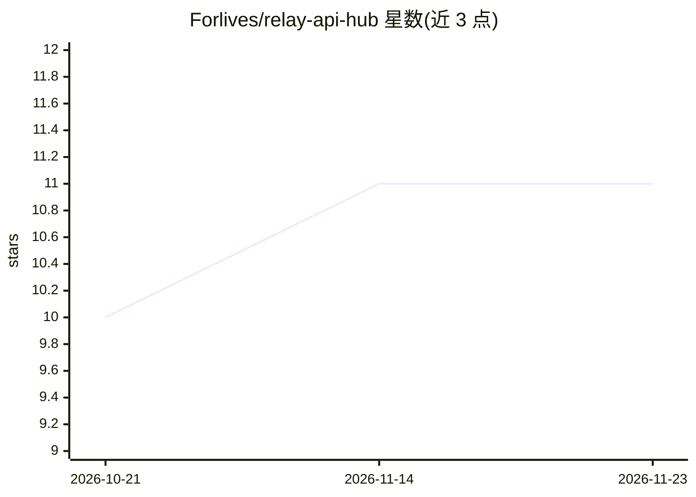

# Forlives/relay-api-hub

⭐ 11 · TypeScript · 推送 2026-04-29 · [GitHub](https://github.com/Forlives/relay-api-hub) · [官网](https://detect.713812.xyz) · 个人维护 · 中文 README

**检测 AI API 中转站是否用廉价模型冒充原模型**

API 纯净度检测器：用户输入中转站地址、Key 与模型名后，工具通过 SSE 协议指纹、模型身份验证、知识截止验证、推理能力基线、代码生成质量、响应一致性 6 个维度，将返回行为与官方 API 基线（参考 BridgeBench 评测数据）对比，输出各维度分数与综合评定（通过/轻微异常/可疑/高度疑似掺水）。提供在线版与本地部署版；后端无状态，不存储 API Key、不记录日志。技术栈为 React 18 + Node.js/Express，支持 Claude、GPT、Gemini、DeepSeek 四个模型家族。

## 筛选速览

| 维度 | 判定 | 备注 |
|---|---|---|
| AI 角色 | `ai-ecosystem` | LLM/agent 周边工具 |
| 许可风险 | `none` | — |
| 部署形态 | `None` |  |
| 模型依赖 | — | README 未给出锁定关系 |
| 硬件要求 | — | 无带数字的原话,不猜 |
| 安装摩擦 | `low` | 无编译、无系统依赖或容器化 |
| 成熟度 | — | 结构信号不足 |

## 能力要点

- 协议级指纹分析：SSE 事件链结构等 6 维度与官方基线 1:1 对比
- 输出四档综合评定：通过/轻微异常/存在可疑/高度疑似掺水
- 后端无状态、不存储 Key、检测请求在本地发出
- 提供 HTTP 检测接口 POST /api/detect

## 适用场景

- 购买前检测中转站 API 是否用廉价模型冒充
- 排查已有 API 通道是否被替换为低端模型
- 本地部署对自有 API 通道做纯净度自检

## 场景标签

`模型评测` · 领域:评测与运维

## 证据(README 行号)

> L3: > 你买的 API 掺水了吗？用 6 个维度对比官方基线，告诉你 API 到底纯不纯。
> L15: 与传统的「问几道题」式检测不同，本工具采用 **协议级指纹分析**，将被测 API 与**真实官方 API 的已知行为基线**做 1:1 对比。
> L17: 检测算法参考了 BridgeBench 的多维度评测方法论：通过推理准确率、代码生成质量、响应一致性等维度建立可量化的模型能力指纹，据此判断 API 服务是否存在模型替换。

## 星数曲线

2026-10-21 10 → 2026-11-23 11（+1）

---
*卡片 v1 · prompt 1.4 · 生成 2026-11-19 · 置信度 high · 依据 README sha `063c37596c94` · [字段定义](../../DATASET.md)*
