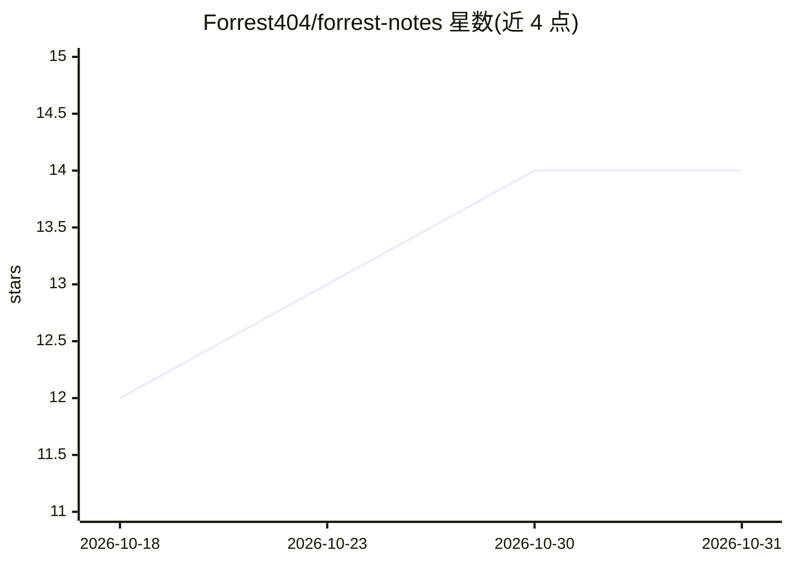

# Forrest404/forrest-notes

⭐ 14 · C · MIT · 推送 2026-06-24 · [GitHub](https://github.com/Forrest404/forrest-notes) · 个人维护

**ESP32-S3 墨水屏语音笔记硬件固件：录音转写并用 AI 整理成 Markdown 同步 GitHub**

基于 Pala Note 固件的分支，面向 Waveshare ESP32-S3 1.54 英寸墨水屏开发板。一键录音后调用 OpenAI Whisper 转写，再用 gpt-4o-mini 把口语重写为连贯笔记，生成标题、一句话摘要与话题链接，原始转写保留在折叠标注中；笔记以 Markdown 推送到用户自己的 GitHub 仓库，可配合 Obsidian 使用。新增运行时配网热点（Wi-Fi 与密钥存于设备 NVS）、TLS 校验、OTA 更新与日历事件提取。需自行准备 OpenAI API key、GitHub PAT 与 2.4 GHz Wi-Fi，通过 arduino-cli 编译烧录固件。

## 筛选速览

| 维度 | 判定 | 备注 |
|---|---|---|
| AI 角色 | `ai-native` | 本体是模型或模型工具 |
| 许可风险 | `permissive` | MIT |
| 部署形态 | `None` |  |
| 模型依赖 | — | README 未给出锁定关系 |
| 硬件要求 | — | 无带数字的原话,不猜 |
| 安装摩擦 | `low` | 无编译、无系统依赖或容器化 |
| 成熟度 | — | 结构信号不足 |

## 能力要点

- Whisper 转写 + gpt-4o-mini 将口语整理为连贯笔记并生成标题/摘要/话题链接
- 笔记以 Markdown 推送到用户 GitHub 仓库，配合 Obsidian 使用
- ForrestNote-Setup 配网热点在设备端存储 Wi-Fi 与密钥（NVS）
- 支持 OTA 更新与真实 TLS 校验

## 适用场景

- 不带手机时用单键硬件快速记录语音笔记
- 把口语自动整理成结构化 Markdown 笔记进 Obsidian 库
- 从语音笔记中提取带日期的日程事件

## 场景标签

`语音识别` `AI 写作` · 领域:内容生成

## 证据(README 行号)

> L3: **A pocket voice-note device that records your voice, transcribes it, and uses AI to turn rambling speech into clean
> L10: - **On-device transcription** via OpenAI Whisper.
> L11: - **AI note cleanup (the headline upgrade):** a language model rewrites your messy, filler-filled speech into **coh

## 星数曲线

2026-10-18 12 → 2026-10-31 14（+2）

---
*卡片 v1 · prompt 1.4 · 生成 2026-10-31 · 置信度 high · 依据 README sha `513e6a65feea` · [字段定义](../../DATASET.md)*
