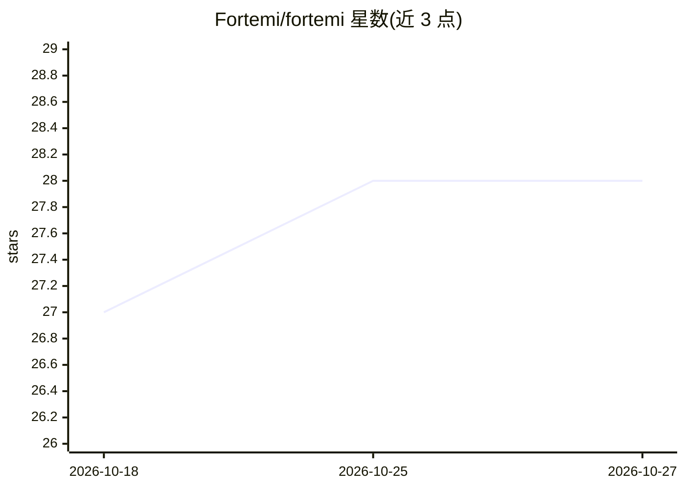

# Fortemi/fortemi

⭐ 28 · Rust · NOASSERTION · 推送 2026-10-24 · [GitHub](https://github.com/Fortemi/fortemi) · 组织维护

**面向 AI 应用的自托管智能知识库，供 RAG 与 agent 记忆使用**

Rust + PostgreSQL 实现的自托管知识库：将笔记、文件与多媒体数据转为可搜索、可关联、带溯源的结构。提供 BM25+稠密向量+RRF 融合的混合检索、基于 SKOS 的知识图谱、131 种文档类型的自动检测与分块、13 种提取适配器（视觉描述、Whisper 转录、说话人分离、视频场景分析等）。通过 MCP 服务器暴露 44 个 agent 工具，推理支持 Ollama、OpenAI、OpenRouter、llama.cpp 等多供应商热切换。面向团队与后端部署，配套桌面应用 HotM（另一仓库）面向单机用户；可在 8GB GPU 或纯 CPU 上运行，默认依赖宿主机 Ollama。

## 筛选速览

| 维度 | 判定 | 备注 |
|---|---|---|
| AI 角色 | `ai-ecosystem` | LLM/agent 周边工具 |
| 许可风险 | `none` | NOASSERTION |
| 部署形态 | `desktop` | 安装包/桌面程序 |
| 模型依赖 | local-ok | 支持本地模型 |
| 硬件要求 | `cpu-ok` | |
| 安装摩擦 | `low` | 无编译、无系统依赖或容器化 |
| 成熟度 | — | 结构信号不足 |

## 能力要点

- BM25+稠密向量+RRF 融合的混合检索，支持多语言分词与搜索运算符
- 知识图谱：>70% 嵌入相似度自动链接、SNN/PFNET/Louvain 社区检测
- 13 种提取适配器与 131 种文档类型的自动检测与差异化处理
- 44 个 MCP agent 工具，多供应商 LLM 推理热切换

## 适用场景

- 为 AI agent 或 RAG 应用提供带溯源的知识底座与 MCP 工具集
- 把音频、视频、邮件等非结构化资料转为可搜索知识
- 在私有环境（边缘/纯 CPU/单 GPU）部署团队知识库

## 场景标签

`Agent 记忆` `知识库管理` `知识图谱` `文档解析` · 领域:Agent 开发

## 证据(README 行号)

> L7: A normalized data schema plus data-science and processing tooling for turning messy organizational data into searcha
> L94: - **44 MCP agent tools** — Model Context Protocol integration for AI agent workflows
> L107: 1. **Ingest** — Notes, files, and media enter via REST API or MCP tools

## 星数曲线

2026-10-18 27 → 2026-10-27 28（+1）

---
*卡片 v1 · prompt 1.4 · 生成 2026-10-26 · 置信度 high · 依据 README sha `f66410917fe4` · [字段定义](../../DATASET.md)*
