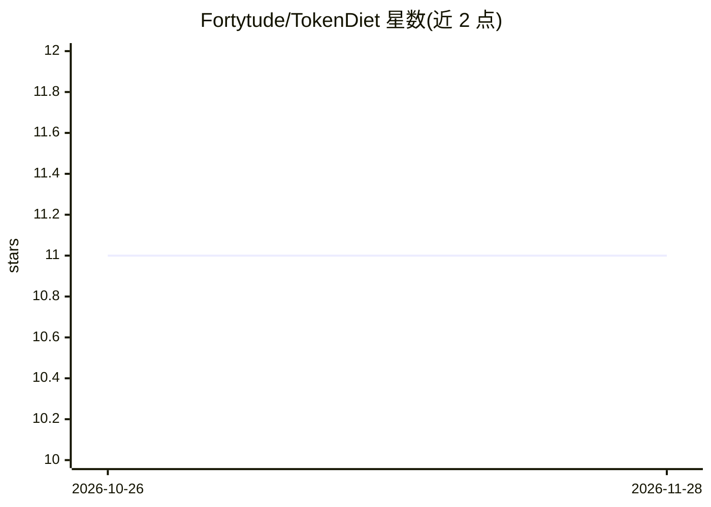

# Fortytude/TokenDiet

⭐ 11 · MIT · 推送 2026-07-08 · [GitHub](https://github.com/Fortytude/TokenDiet) · [官网](https://tokendiet.dev) · 组织维护

**给用 Claude Code 的开发者的仓库 LLM 成本浪费审计插件**

以 Claude Code 插件形式分发（另提供 Cursor/Copilot/Codex 目录），安装后在用户本地由用户自己的 agent 与 token 执行审计：按约 20 条 LLM 成本浪费模式清单匹配代码中的 LLM 调用点，覆盖 Python 与 TS/JS，定位到 file:line 并给出修复建议；发现按可安全机械修复、需自行验证、护栏信息三类分组。关键限制：静态分析仅能覆盖直接 SDK 调用与可追踪的包装器，不追踪动态分发；不产出任何金额估算，只定性描述并引用公开费率。无服务端、无账号、代码不离开本机。

## 筛选速览

| 维度 | 判定 | 备注 |
|---|---|---|
| AI 角色 | `ai-ecosystem` | LLM/agent 周边工具 |
| 许可风险 | `permissive` | MIT |
| 部署形态 | `None` |  |
| 模型依赖 | — | README 未给出锁定关系 |
| 硬件要求 | — | 无带数字的原话,不猜 |
| 安装摩擦 | `low` | 无编译、无系统依赖或容器化 |
| 成熟度 | — | 结构信号不足 |

## 能力要点

- 约 20 条 LLM 成本浪费模式检测：缺失 prompt caching、无上限重试、prompt 冗余、未批处理、模型过配等
- 支持 Python 与 TS/JS，覆盖 OpenAI/Anthropic/Vercel AI SDK/LangChain/LlamaIndex/AWS Bedrock/Gemini/原生 HTTP 调用点
- 由用户自己的 agent 在本地运行，代码不出本机，无服务端与 API key
- 诚实契约：引用公开费率但不编造节省金额，每条发现须指向真实 file:line

## 适用场景

- 合并 PR 前快速审计刚写的 LLM 调用代码有无成本浪费
- 检查仓库里同一 system prompt 未缓存等重复计费模式
- 给团队做 LLM 调用成本护栏巡检（重试上限、消费上限、用量埋点）

## 场景标签

`代码审查` · 领域:编码与开发

## 证据(README 行号)

> L5: A Claude Code plugin that audits your own repo for wasteful LLM API spend — missing prompt caching, uncapped retries
> L79: The plugin ships a catalog of ~20 LLM-cost waste patterns. It matches each call-site against them — in Python **and
> L124: The plugin is a slash command plus a skill — a body of LLM-cost knowledge (the waste catalog, per-provider detecti

## 星数曲线

2026-10-26 11 → 2026-11-28 11（+0）

---
*卡片 v1 · prompt 1.4 · 生成 2026-11-19 · 置信度 high · 依据 README sha `ac506d081288` · [字段定义](../../DATASET.md)*
