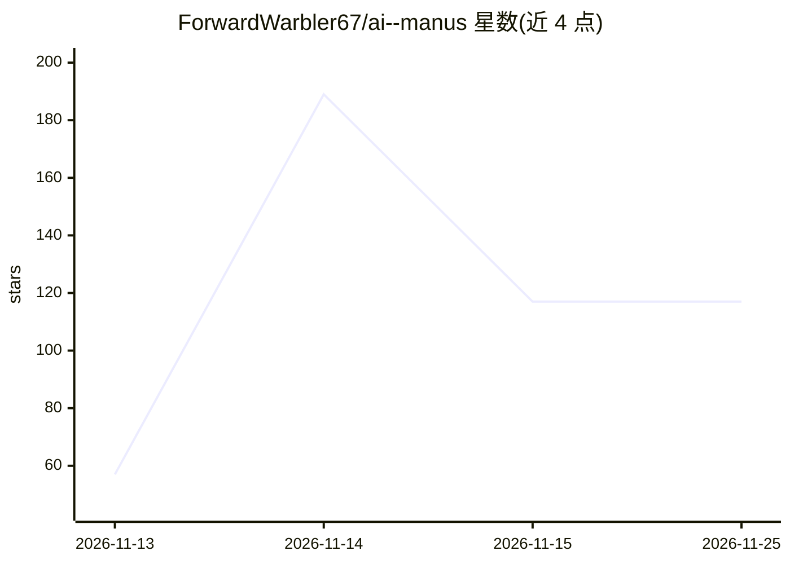

# ForwardWarbler67/ai--manus

⭐ 117 · Apache-2.0 · 推送 2026-11-15 · [GitHub](https://github.com/ForwardWarbler67/ai--manus) · 个人维护

**自主 AI Agent：代替用户执行代码与控制浏览器完成任务**

面向家庭、学习与轻办公场景的自主 AI 代理：用户以自然语言描述需求，代理自行规划步骤，可编写并执行脚本、打开网页、与页面元素交互、执行多步骤任务，代码执行与浏览器操作可在同一流程中衔接；会话间记忆工作模式以便复用。README 声明其定位为小型任务助手而非企业平台。给出硬件兼容表（最低 4 GB 内存/双核 CPU）。README 未提供具体的安装命令、模型接入方式或代码仓库内容说明，仅有使用步骤与场景描述。

## 筛选速览

| 维度 | 判定 | 备注 |
|---|---|---|
| AI 角色 | `ai-native` | 本体是模型或模型工具 |
| 许可风险 | `permissive` | Apache-2.0 |
| 部署形态 | `None` |  |
| 模型依赖 | — | README 未给出锁定关系 |
| 硬件要求 | — | 无带数字的原话,不猜 |
| 安装摩擦 | `low` | 无编译、无系统依赖或容器化 |
| 成熟度 | — | 结构信号不足 |

## 能力要点

- 自主编写并执行代码完成任务
- 浏览器控制：导航页面、填表、采集信息
- 代码与浏览器操作在同一工作流中衔接
- 会话间保持任务模式的一致性

## 适用场景

- 让代理代为完成查网页、填表格等重复操作
- 学生组织研究资料、跑小型脚本计算
- 远程工作者从多页面收集数据并整理摘要
- 小型项目的日常事务自动化

## 场景标签

`工作流自动化` `浏览器自动化` `AI 助手` · 领域:效率与自动化

## 证据(README 行号)

> L10: - **Autonomous Code Execution:** Manus AI agent runs code on its own to complete tasks, so you can focus on decisio
> L18: Manus is an autonomous AI agent designed to run code and control a browser on your behalf. Instead of acting like a

## 星数曲线

2026-11-13 57 → 2026-11-25 117（+60）

---
*卡片 v1 · prompt 1.4 · 生成 2026-11-17 · 置信度 mid · 依据 README sha `0f78ee3a5dd2` · [字段定义](../../DATASET.md)*
