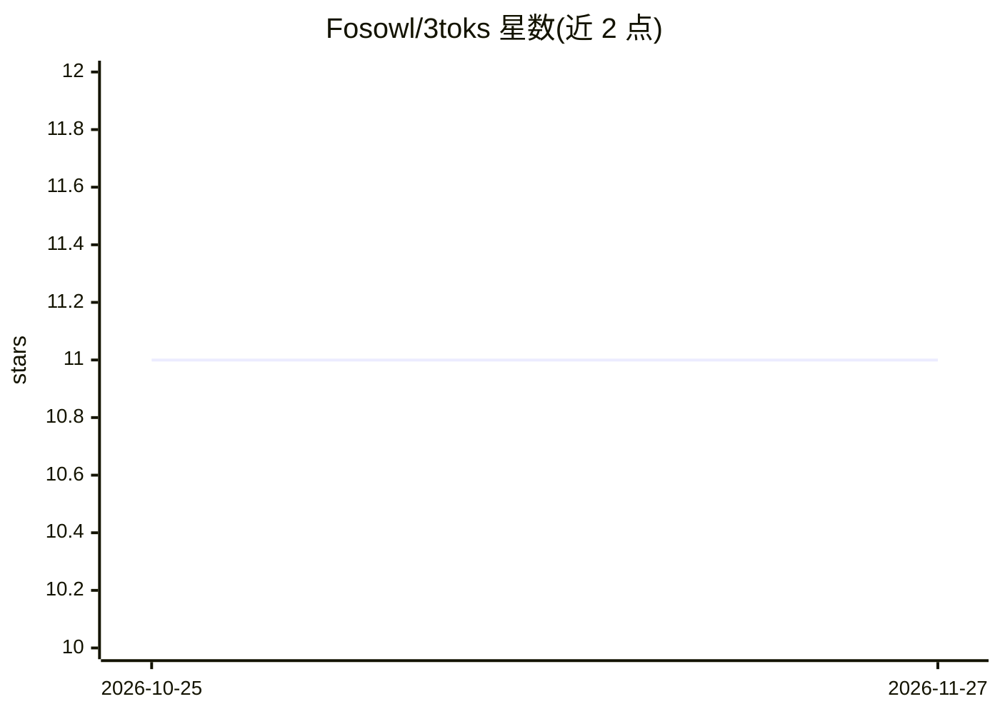

# Fosowl/3toks

⭐ 11 · Python · MIT · 推送 2026-11-25 · [GitHub](https://github.com/Fosowl/3toks) · 个人维护

**面向小型本地 LLM 的低 token 消耗 agent 框架**

ThreeToks 是一个在本机运行的 AI agent 框架，面向小参数量语言模型。其机制是让模型只做选择而非生成文本：每步从编号菜单中选一个数字（约 1-3 个 token），由常规代码执行读网页、记笔记、回退等精确操作，并用 judge 检查最终答案。核心无需额外依赖包，web/browser/voice/camera/relay 等功能以可选 add-on 形式安装。目标是在 4 GB 以下内存的机器上用 1.5b 模型可用，每步决策小于一秒。通过 uv 从源码安装，默认搭配 Ollama 模型服务器。

## 筛选速览

| 维度 | 判定 | 备注 |
|---|---|---|
| AI 角色 | `ai-ecosystem` | LLM/agent 周边工具 |
| 许可风险 | `permissive` | MIT |
| 部署形态 | `library` | 以包/库形式分发 |
| 模型依赖 | local-ok | 支持本地模型 |
| 硬件要求 | — | 无带数字的原话,不猜 |
| 安装摩擦 | `low` | 无编译、无系统依赖或容器化 |
| 成熟度 | — | 结构信号不足 |

## 能力要点

- 模型每步只输出 1-3 个 token 的菜单选择，代码执行其余精确工作
- 核心零依赖包，web/语音/摄像头等功能按 add-on 可选安装
- 路由与投票机制缓解小模型输出不稳定问题
- 内置终端配置面板，支持热更新设置与 doctor 自检命令

## 适用场景

- 在没有 GPU 的低内存旧电脑上运行本地 agent
- 用小型本地模型做带来源记录的联网问答与研究
- 需要语音输入输出或摄像头视觉的本地助手
- 在树莓派上通过 relay add-on 控制灯等外设

## 场景标签

`Agent 框架` `AI 助手` · 领域:Agent 开发

## 证据(README 行号)

> L18: **ThreeToks is a small AI agent that runs on your own computer.**
> L43: 1. The code builds a **tree of decisions**. Each decision is a numbered menu.
> L233: Every request goes through a **router**. The router shows the model a menu of agent names. Each name has a one-lin

## 星数曲线

2026-10-25 11 → 2026-11-27 11（+0）

---
*卡片 v1 · prompt 1.4 · 生成 2026-11-19 · 置信度 high · 依据 README sha `a9d153b38a28` · [字段定义](../../DATASET.md)*
