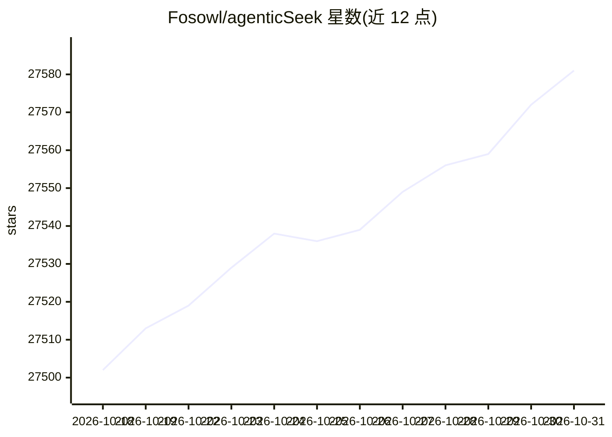

# Fosowl/agenticSeek

⭐ 27,581 · Python · GPL-3.0 · 推送 2026-10-22 · [GitHub](https://github.com/Fosowl/agenticSeek) · [官网](http://agenticseek.tech) · 个人维护 · 中文 README

**本地运行的自主 AI 代理：浏览网页、写代码、规划任务**

一个完全本地运行的自主代理助手，通过本地推理模型在用户硬件上完成网页搜索、信息提取、表单填写，以及 Python/C/Go/Java 等语言的代码编写与调试；可自动选择代理并把大任务拆分为步骤执行，附带语音输入功能（标注为进行中）。运行依赖 Python 3.10.x、Docker（含 SearxNG、Redis 等服务），通过 config.ini 配置本地或云端提供商；硬件不足以本地运行 LLM 时可改用 API 方式。

## 筛选速览

| 维度 | 判定 | 备注 |
|---|---|---|
| AI 角色 | `ai-native` | 本体是模型或模型工具 |
| 许可风险 | `viral` | GPL-3.0 |
| 部署形态 | `desktop` | 安装包/桌面程序 |
| 模型依赖 | local-ok | 支持本地模型 |
| 硬件要求 | — | 无带数字的原话,不猜 |
| 安装摩擦 | `low` | 无编译、无系统依赖或容器化 |
| 成熟度 | — | 结构信号不足 |

## 动量与使用信号

- 维护:`active` — 距上次 push 2.5 天,年发版 0,44 位贡献者
- 涨星:近 1 天 **+3**(自 20261016 起算)
- 安装:github 包 `release-assets` 月下载无数据
- 平台:WINDOWS / LINUX / WEB · 协议:OPENAI-API / OLLAMA

## 能力要点

- 完全本地运行，数据不离开设备，API key 对本地运行用户为可选项
- 自主网页浏览：搜索、读取、提取信息、填写表单
- 自动选择代理并拆分执行多步任务
- 支持 ollama、lm-studio、openai 兼容 API 等本地提供商

## 适用场景

- 在本地硬件上运行隐私优先的自主代理
- 让代理自动搜索网页并汇总信息
- 让代理自主编写和调试代码

## 场景标签

`AI 助手` `浏览器自动化` `编码 Agent` · 领域:效率与自动化

## 证据(README 行号)

> L7: *A **100% local alternative to Manus AI**, this voice-enabled AI assistant autonomously browses the web, writes code
> L116: To run LLMs locally, you'll need sufficient hardware. At a minimum, a GPU capable of running Magistral, Qwen or De
> L241: By default AgenticSeek is run fully in docker.

## 星数曲线

2026-10-18 27,502 → 2026-10-31 27,581（+79）

---
*卡片 v1 · prompt 1.4 · 生成 2026-10-18 · 置信度 high · 依据 README sha `b60ab5d1b538` · [字段定义](../../DATASET.md)*
