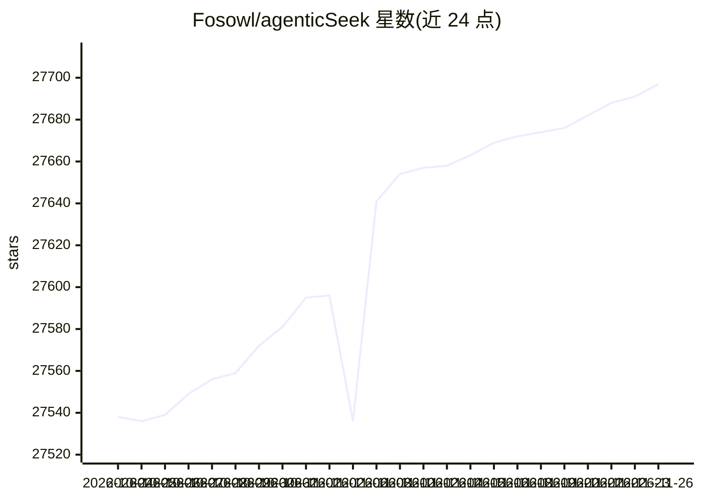

# Fosowl/agenticSeek

⭐ 27,697 · Python · GPL-3.0 · 推送 2026-11-17 · [GitHub](https://github.com/Fosowl/agenticSeek) · [官网](http://agenticseek.tech) · 个人维护 · 中文 README

**全本地自主 AI 助手：浏览网页、写代码，数据不出设备**

定位为 Manus 的 100% 本地替代品：一个语音可用的自主 agent，可自主浏览网页、搜索、填写表单，并用 Python/C/Go/Java 等语言编写、调试、运行程序；内置自动 agent 选择与任务拆解执行机制。默认以 Docker 全栈运行（SearxNG + Redis + 前端），也可 CLI 模式在主机运行；本地 LLM 经 ollama/lm-studio/openai 兼容 API 接入，硬件不足时可切换云端 API。API key 对本地运行完全可选。

## 筛选速览

| 维度 | 判定 | 备注 |
|---|---|---|
| AI 角色 | `ai-native` | 本体是模型或模型工具 |
| 许可风险 | `viral` | GPL-3.0 |
| 部署形态 | `desktop` | 安装包/桌面程序 |
| 模型依赖 | local-ok | 支持本地模型 |
| 硬件要求 | — | 无带数字的原话,不猜 |
| 安装摩擦 | `low` | 无编译、无系统依赖或容器化 |
| 成熟度 | — | 结构信号不足 |

## 动量与使用信号

- 维护:`active` — 距上次 push 2.5 天,年发版 0,44 位贡献者
- 涨星:近 1 天 **+3**(自 20261016 起算)
- 安装:github 包 `release-assets` 月下载无数据
- 平台:WINDOWS / LINUX / WEB · 协议:OPENAI-API / OLLAMA

## 能力要点

- 自主网页浏览：搜索、读取、提取信息、填写表单
- 自主编码：写、调试并运行多语言程序
- 自动 agent 选择与多 agent 任务拆解执行
- 语音/语音转文本交互（开发中）

## 适用场景

- 完全离线/隐私环境下运行自主 agent 助手
- 让 agent 自动搜索资料并汇总结果
- 让 agent 自动编写并运行脚本完成任务

## 场景标签

`AI 助手` `多智能体` `浏览器自动化` · 领域:Agent 开发

## 证据(README 行号)

> L7: *A **100% local alternative to Manus AI**, this voice-enabled AI assistant autonomously browses the web, writes code
> L116: To run LLMs locally, you'll need sufficient hardware. At a minimum, a GPU capable of running Magistral, Qwen or De
> L145: provider_name = ollama # or lm-studio, openai, etc..

## 星数曲线

2026-10-24 27,538 → 2026-11-26 27,697（+159）

---
*卡片 v1 · prompt 1.4 · 生成 2026-11-22 · 置信度 high · 依据 README sha `7be784a23945` · [字段定义](../../DATASET.md)*
