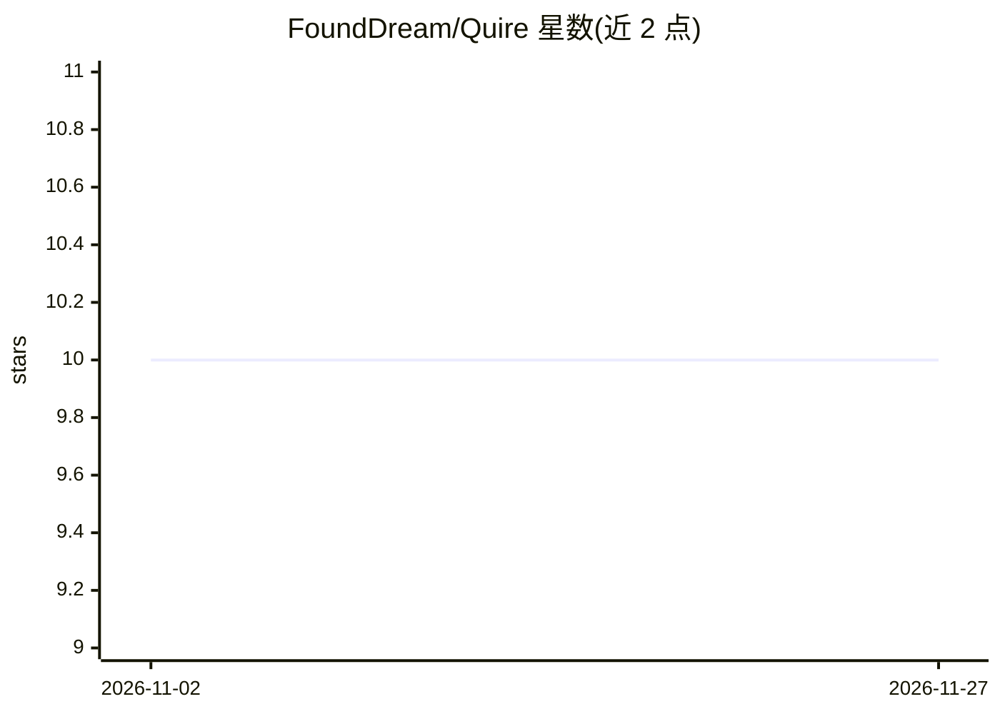

# FoundDream/Quire

⭐ 10 · HTML · MIT · 推送 2026-05-17 · [GitHub](https://github.com/FoundDream/Quire) · [官网](https://founddream.github.io/Quire/) · 个人维护 · 中文 README

**供 AI agent 生成排版 PDF 编辑文档的设计系统技能**

Quire 是一个面向编辑类文档（白皮书、单页报告、playbook、落地页、幻灯片）的约束型设计系统：锁定冷色调画布与单一天蓝色强调色，以衬线字体承载层级，提供共享 CSS、可填写 HTML 模板、构建脚本与 linter，产出排版 PDF。以 agent skill 形式分发（SKILL.md 入口，含触发词与决策步骤），通过 skills CLI 或 git clone 安装，供 Claude Code、Cursor、Codex、Goose 等 agent 在用户提出文档生成请求时调用。结构参考自 tw93/kami，MIT 许可。

## 筛选速览

| 维度 | 判定 | 备注 |
|---|---|---|
| AI 角色 | `ai-knowledge` | 知识聚合/清单类 |
| 许可风险 | `permissive` | MIT |
| 部署形态 | `library` | 以包/库形式分发 |
| 模型依赖 | — | README 未给出锁定关系 |
| 硬件要求 | — | 无带数字的原话,不猜 |
| 安装摩擦 | `low` | 无编译、无系统依赖或容器化 |
| 成熟度 | — | 结构信号不足 |

## 能力要点

- 五种文档形态（白皮书/单页报告/落地页/playbook/幻灯）共享同一套设计语言
- 以 SKILL.md 形式的 agent skill 分发，含触发词与工作模式定义
- skills CLI 一条命令安装，支持 Claude Code/Cursor/Codex/Goose 等多种 agent
- 附带 build.sh 构建脚本与 check.py linter

## 适用场景

- 让 AI agent 把内容排版成白皮书或报告 PDF
- 为团队文档统一使用一套固定的设计规范
- 生成演示幻灯片 HTML 与排版版本

## 场景标签

`AI 写作` · 领域:内容生成

## 证据(README 行号)

> L14: Quire is a constraint system for editorial documents — playbooks, white papers, single-page reports — that share on
> L39: One command, works with Claude Code, Cursor, Codex, Goose, and every other agent the skills CLI supports:
> L85: - **`SKILL.md`** — agent entry point: triggers, decision steps, working modes

## 星数曲线

2026-11-02 10 → 2026-11-27 10（+0）

---
*卡片 v1 · prompt 1.4 · 生成 2026-11-20 · 置信度 high · 依据 README sha `798dfca1fec4` · [字段定义](../../DATASET.md)*
