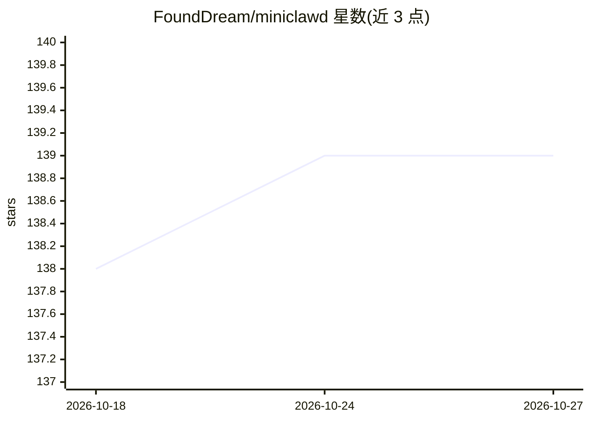

# FoundDream/miniclawd

⭐ 139 · TypeScript · 推送 2026-02-11 · [GitHub](https://github.com/FoundDream/miniclawd) · [官网](https://founddream.github.io/miniclawd/) · 个人维护 · 中文 README

**TypeScript 编写的轻量个人 AI 助手，多模型多渠道**

基于 TypeScript + Bun 实现的个人 AI 助手，约 5900 行代码。支持 Anthropic、OpenAI、Google、OpenRouter、Groq、AWS Bedrock 等多家模型提供商，通过 Telegram、飞书（Lark）渠道对话；内置文件读写、shell 执行、网页搜索与抓取工具，支持 Markdown 技能扩展、长期记忆、Cron 定时任务与后台子代理。用户通过 miniclawd CLI 命令初始化配置（~/.miniclawd/config.json）并交互或启动网关。

## 筛选速览

| 维度 | 判定 | 备注 |
|---|---|---|
| AI 角色 | `ai-native` | 本体是模型或模型工具 |
| 许可风险 | `none` | — |
| 部署形态 | `library` | 以包/库形式分发 |
| 模型依赖 | locked-api |  |
| 硬件要求 | — | 无带数字的原话,不猜 |
| 安装摩擦 | `low` | 无编译、无系统依赖或容器化 |
| 成熟度 | — | 结构信号不足 |

## 能力要点

- 多 LLM 提供商支持：Anthropic/OpenAI/Google/OpenRouter/Groq/AWS Bedrock
- Telegram 与飞书（Lark）多渠道网关
- 内置工具：文件 I/O、shell 执行、网页搜索与抓取
- Markdown 技能扩展、持久记忆与 Cron 调度

## 适用场景

- 在 Telegram 或飞书上运行自己的 AI 助手
- 通过 CLI 进行单次或交互式对话
- 用定时任务与后台子代理执行自动化任务

## 场景标签

`AI 助手` · 领域:对话与助手

## 证据(README 行号)

> L3: A lightweight personal AI assistant with multi-channel support.
> L14: - **Multi-LLM Support** — Anthropic, OpenAI, Google, OpenRouter, Groq, AWS Bedrock

## 星数曲线

2026-10-18 138 → 2026-10-27 139（+1）

---
*卡片 v1 · prompt 1.4 · 生成 2026-10-22 · 置信度 high · 依据 README sha `4e4a790c1a3c` · [字段定义](../../DATASET.md)*
