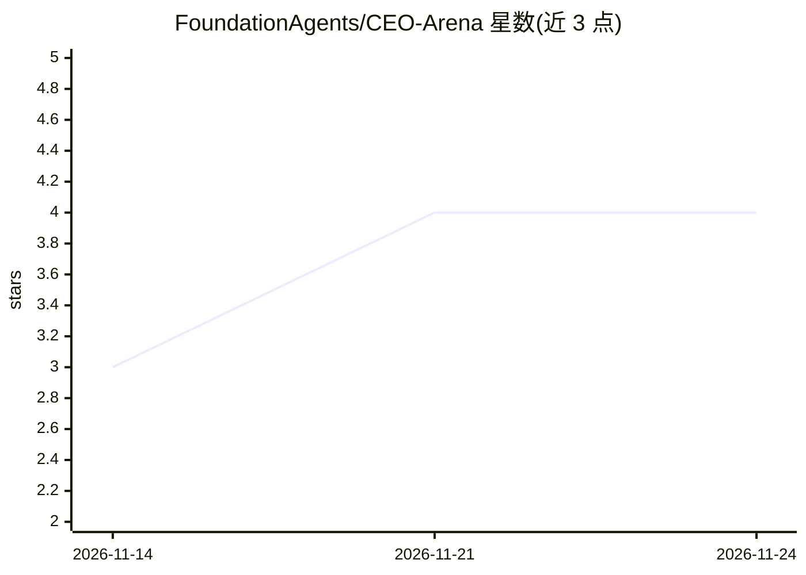

# FoundationAgents/CEO-Arena

⭐ 4 · Python · MIT · 推送 2026-10-29 · [GitHub](https://github.com/FoundationAgents/CEO-Arena) · [官网](https://arxiv.org/abs/2609.34821) · 组织维护 · 中文 README

**竞争市场中多智能体长程决策的评测基准代码与数据**

论文《CEO Arena: Evaluating Long-Horizon Multi-Agent Decision-Making in Competitive Markets》的官方代码与发布结果：八个 LLM CEO 在共享市场中经营公司，就定价、采购、营销、研发和服务做决策；确定性经济模拟器结算动作并计算回报，评测不使用 LLM judge。主评测为 500 模拟日、27 个主市场与 26 个补充市场，含匹配替换对照（LLM CEO 与规则 CEO）。快速启动无需模型 API；运行新模型实验需 Node.js/npm、Bun、OpenCode 子模块与外部模型端点。

## 筛选速览

| 维度 | 判定 | 备注 |
|---|---|---|
| AI 角色 | `ai-knowledge` | 知识聚合/清单类 |
| 许可风险 | `permissive` | MIT |
| 部署形态 | `None` |  |
| 模型依赖 | — | README 未给出锁定关系 |
| 硬件要求 | — | 无带数字的原话,不猜 |
| 安装摩擦 | `low` | 无编译、无系统依赖或容器化 |
| 成熟度 | — | 结构信号不足 |

## 能力要点

- 确定性经济模拟器结算动作，评测不使用 LLM judge
- 发布 27 个主市场与 26 个补充市场的离线可复现结果
- 匹配替换设计：同公司与经济种子下对比规则 CEO
- 评分公式为期末现金+库存残值+付费入站股票−初始企业价值

## 适用场景

- 离线验证并复现论文发布的市场结果
- 将自己接入的 LLM 作为 CEO 运行市场评测
- 分析多智能体长程决策的机制分解与记忆/动作证据

## 场景标签

`模型评测` · 领域:评测与运维

## 证据(README 行号)

> L6: Official code and released results for **CEO Arena: Evaluating Long-Horizon Multi-Agent Decision-Making in Competiti
> L10: CEO Arena evaluates agents that operate competing companies in one shared market. CEOs make decisions about pricing
> L12: The main evaluation runs eight companies for 500 simulated days. Matched replacements compare each LLM CEO with a r

## 星数曲线

2026-11-14 3 → 2026-11-24 4（+1）

---
*卡片 v1 · prompt 1.4 · 生成 2026-11-21 · 置信度 high · 依据 README sha `f8b3a25dbe18` · [字段定义](../../DATASET.md)*
