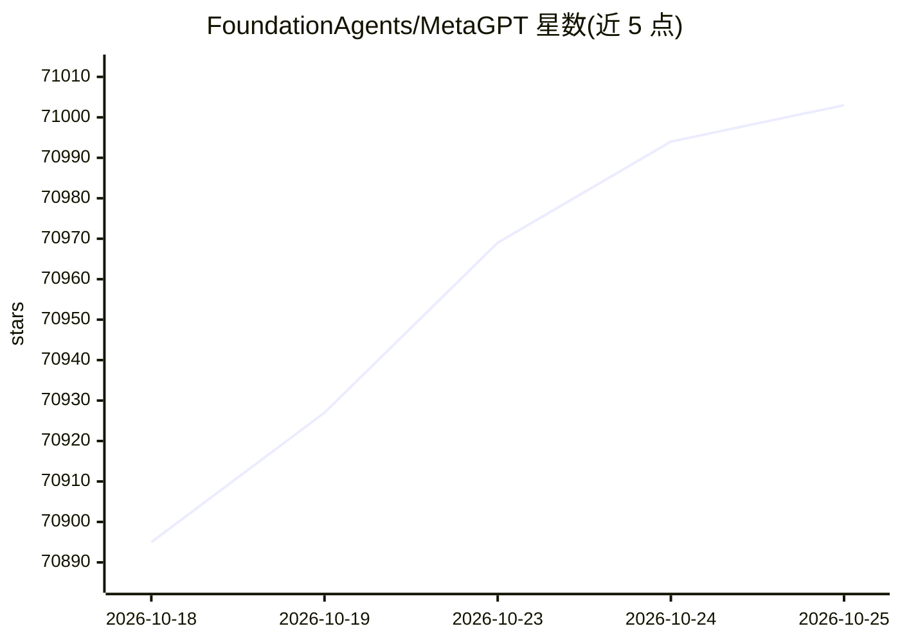

# FoundationAgents/MetaGPT

⭐ 71,014 · Python · MIT · 推送 2026-01-21 · [GitHub](https://github.com/FoundationAgents/MetaGPT) · [官网](https://atoms.dev/) · 组织维护 · 中文 README

**多智能体框架：模拟软件公司角色协作完成复杂任务**

MetaGPT 接收一行需求作为输入，输出用户故事、竞品分析、需求文档、数据结构、API 等产物；内部模拟软件公司中的产品经理、架构师、项目经理、工程师等角色，通过编排 SOP（Code = SOP(Team)）驱动 LLM 组成的团队协作。以 Python 库与 CLI 形式提供，需 Python 3.9–3.12，实际使用前需安装 node 和 pnpm，支持 pip/源码/docker 安装，并支持以库形式调用与 Data Interpreter 写代码。

## 筛选速览

| 维度 | 判定 | 备注 |
|---|---|---|
| AI 角色 | `ai-native` | 本体是模型或模型工具 |
| 许可风险 | `permissive` | MIT |
| 部署形态 | `library` | 以包/库形式分发 |
| 模型依赖 | — | README 未给出锁定关系 |
| 硬件要求 | — | 无带数字的原话,不猜 |
| 安装摩擦 | `low` | 无编译、无系统依赖或容器化 |
| 成熟度 | — | 结构信号不足 |

## 动量与使用信号

- 维护:`declining` — 距上次 push 269.9 天,年发版 0,116 位贡献者
- 涨星:近 1 天 **+21**(自 20261016 起算)
- 安装:pypi 包 `metagpt` 月下载 3,393
- 平台:— · 协议:OLLAMA

## 能力要点

- 一行需求生成用户故事/需求/数据结构/API 等多类产物
- 内置产品经理/架构师/项目经理/工程师等 LLM 角色与 SOP 编排
- 支持 CLI 用法与 Python 库调用，附 Data Interpreter 数据分析角色
- 配置中支持 openai/azure/ollama/groq 等多种 LLM 接入类型

## 适用场景

- 输入一句需求自动生成包含代码与文档的仓库
- 构建自己的多智能体工作流与自定义 agent
- 用 Data Interpreter 进行数据分析类代码生成任务

## 场景标签

`多智能体` `Agent 框架` `数据分析` · 领域:Agent 开发

## 证据(README 行号)

> L31: 1. MetaGPT takes a **one line requirement** as input and outputs **user stories / competitive analysis / requiremen
> L32: 2. Internally, MetaGPT includes **product managers / architects / project managers / engineers.** It provides the e
> L69:   api_type: "openai"  # or azure / ollama / groq etc. Check LLMType for more options

## 星数曲线

2026-10-18 70,895 → 2026-10-25 71,003（+108）

---
*卡片 v1 · prompt 1.4 · 生成 2026-10-18 · 置信度 high · 依据 README sha `aee72e61e176` · [字段定义](../../DATASET.md)*
