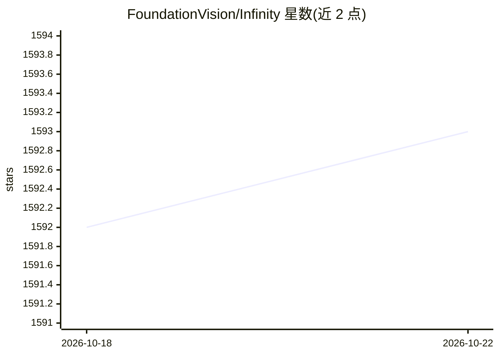

# FoundationVision/Infinity

⭐ 1,593 · Python · MIT · 推送 2026-04-16 · [GitHub](https://github.com/FoundationVision/Infinity) · 组织维护

**逐位自回归文生图模型，生成高分辨率图像**

CVPR 2025 Oral 论文的官方实现：Infinity 以逐位 token 预测框架做视觉自回归建模，配套无限词表量化 tokenizer 与逐位自校正机制，按文本生成 1024×1024 等高分辨率图像。提供 2B/8B 检查点与视觉 tokenizer 权重（HuggingFace 下载）、训练/微调/评测脚本、交互式推理 notebook 与仅推理的 Docker 复现方案；训练要求 torch>=2.5.1 并需自行下载 flan-t5-xl 文本编码器权重。

## 筛选速览

| 维度 | 判定 | 备注 |
|---|---|---|
| AI 角色 | `ai-native` | 本体是模型或模型工具 |
| 许可风险 | `permissive` | MIT |
| 部署形态 | `self-host` | docker 或自建部署 |
| 模型依赖 | — | README 未给出锁定关系 |
| 硬件要求 | — | 无带数字的原话,不猜 |
| 安装摩擦 | `low` | 无编译、无系统依赖或容器化 |
| 成熟度 | — | 结构信号不足 |

## 能力要点

- 逐位 token 预测的自回归文生图框架（2B/8B 检查点，20B 标注 Coming Soon）
- 无限词表视觉 tokenizer（V_d 最高 2^64）训练代码与权重开放
- 单命令训练脚本，支持 125M/1B/2B 规模与 256/512/1024 分辨率
- 提供仅推理的 Docker 复现容器与交互式 notebook

## 适用场景

- 按文本提示生成高分辨率图像
- 在我自己的图文数据上微调文生图模型
- 复现论文训练/评测（GenEval、ImageReward、HPSv2.1、FID）流程

## 场景标签

`图像生成` `微调` `模型训练` · 领域:内容生成

## 证据(README 行号)

> L42: We present Infinity, a Bitwise Visual AutoRegressive Modeling capable of generating high-resolution and photorealis
> L83: 1. We use FlexAttention to speedup training, which requires `torch>=2.5.1`.

## 星数曲线

2026-10-18 1,592 → 2026-10-22 1,593（+1）

---
*卡片 v1 · prompt 1.4 · 生成 2026-10-21 · 置信度 high · 依据 README sha `67ba3cd722a1` · [字段定义](../../DATASET.md)*
