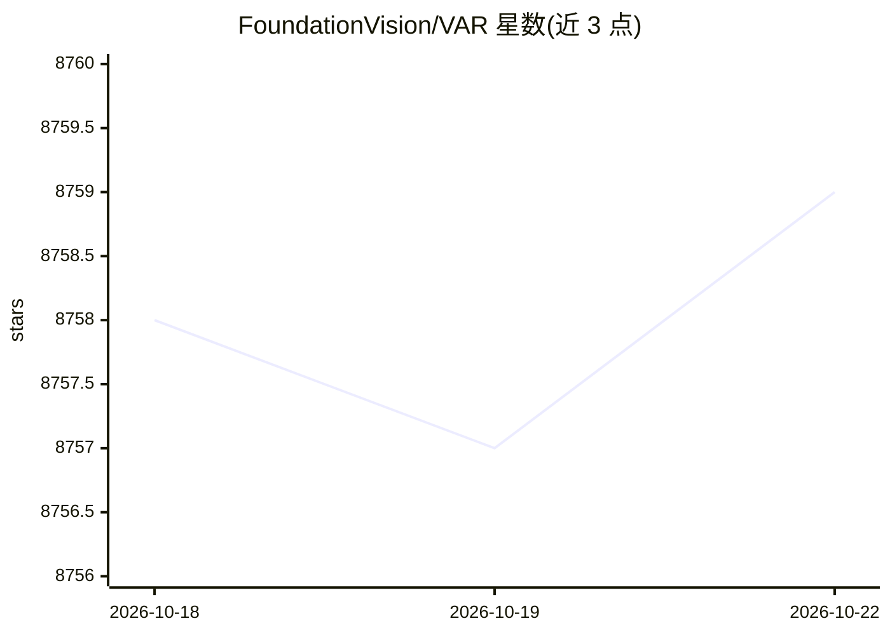

# FoundationVision/VAR

⭐ 8,759 · Jupyter Notebook · MIT · 推送 2025-11-10 · [GitHub](https://github.com/FoundationVision/VAR) · 组织维护

**视觉自回归图像生成模型的官方实现与训练代码**

NeurIPS 2024 最佳论文《Visual Autoregressive Modeling: Scalable Image Generation via Next-Scale Prediction》的官方 PyTorch 实现：将图像自回归学习重新定义为从粗到细的逐尺度预测，区别于光栅扫描的逐 token 预测。面向生成模型研究者，提供 VAR-d16 至 d36 六组预训练权重（310M-2.3B，FID 1.80-3.55）、ImageNet 训练脚本（多卡 torchrun、fp16、自动断点续训）、采样与零样本推理及 FID 评测流程；可选安装 flash-attn/xformers 加速注意力计算。需先下载 VQ tokenizer 权重。

## 筛选速览

| 维度 | 判定 | 备注 |
|---|---|---|
| AI 角色 | `ai-native` | 本体是模型或模型工具 |
| 许可风险 | `permissive` | MIT |
| 部署形态 | `library` | 以包/库形式分发 |
| 模型依赖 | — | README 未给出锁定关系 |
| 硬件要求 | — | 无带数字的原话,不猜 |
| 安装摩擦 | `low` | 无编译、无系统依赖或容器化 |
| 成熟度 | — | 结构信号不足 |

## 能力要点

- 逐尺度预测的视觉自回归建模方法实现
- 提供 310M-2.3B 六组预训练权重（FID 最低 1.80）
- 多卡训练脚本支持 fp16 与断点自动续训
- 零样本推理与 FID/IS/precision/recall 评测流程

## 适用场景

- 复现或改进 VAR 图像生成方法的学术研究
- 加载预训练权重在 ImageNet 类别条件下生成图像
- 基于该代码库开展自回归视觉生成的后续研究（README 汇集 30 余篇第三方工作）

## 场景标签

`图像生成` `模型训练` · 领域:内容生成

## 证据(README 行号)

> L8:  Visual Autoregressive Modeling: Scalable Image Generation via Next-Scale Prediction
> L33: Visual Autoregressive Modeling (VAR) redefines the autoregressive learning on images as coarse-to-fine "next-scale 
> L55: You can load these models to generate images via the codes in demo_sample.ipynb. Note: you need to download vae_ch1

## 星数曲线

2026-10-18 8,758 → 2026-10-22 8,759（+1）

---
*卡片 v1 · prompt 1.4 · 生成 2026-10-20 · 置信度 mid · 依据 README sha `086d5fd02a6c` · [字段定义](../../DATASET.md)*
