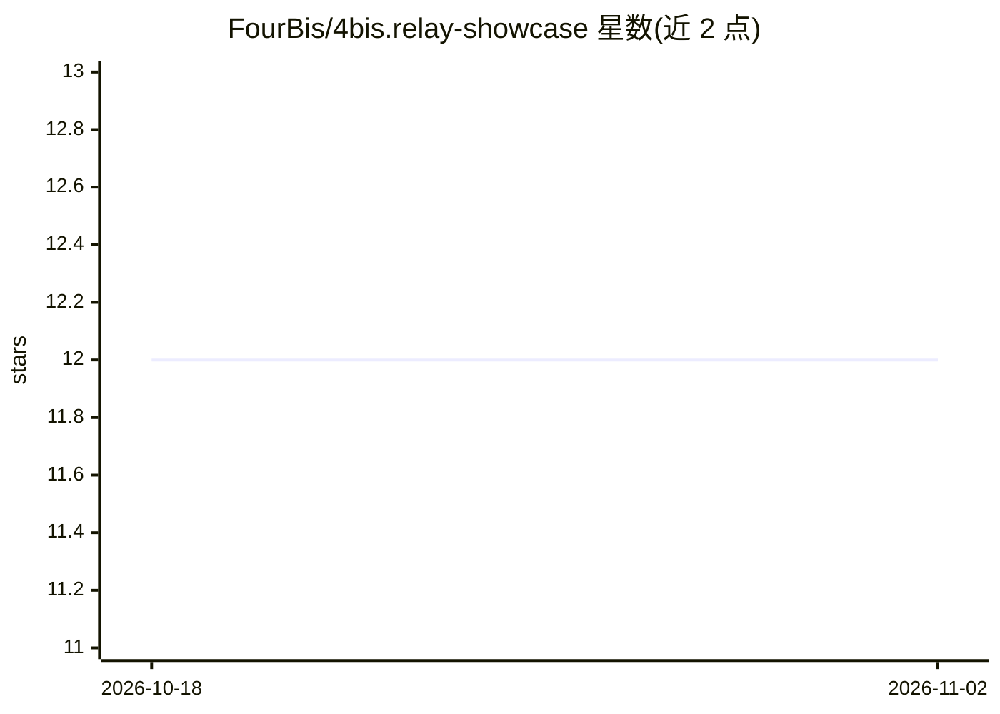

# FourBis/4bis.relay-showcase

⭐ 12 · Python · MIT · 推送 2026-10-26 · [GitHub](https://github.com/FourBis/4bis.relay-showcase) · [官网](https://fourbis.github.io/4bis.relay-showcase/) · 组织维护

**本地 AI 工作区：多仓库对话、持久任务与可审查 PR**

FourBis 开发的实验性本地工作区，将客户、项目、人员与 AI 代理组织在同一空间：注册本地仓库后可配置模型目录、工具（文件/shell/SQL/Git/MCP）、团队成员，通过分角色模型（计划者/执行者/验证者/文档者/压缩者）按阶段或任务图执行工作，支持任务依赖、并行与一次自动细分。代码索引依赖 CBM 组件，PR 发布前做 diff 与检查；README 明确标注为实验性，附验证证据表说明各能力已核实到何种程度。首个管理员通过 GitHub 注册。

## 筛选速览

| 维度 | 判定 | 备注 |
|---|---|---|
| AI 角色 | `ai-native` | 本体是模型或模型工具 |
| 许可风险 | `permissive` | MIT |
| 部署形态 | `desktop` | 安装包/桌面程序 |
| 模型依赖 | — | README 未给出锁定关系 |
| 硬件要求 | — | 无带数字的原话,不猜 |
| 安装摩擦 | `low` | 无编译、无系统依赖或容器化 |
| 成熟度 | `idea` | |

## 能力要点

- 分角色模型配置（计划/执行/验证/文档/压缩），支持 OpenAI/Anthropic/MiniMax/NVIDIA/Ollama 适配器
- CBM 代码图索引：符号、callers/callees、Cypher 查询与 Mermaid/SVG 图表生成
- 任务图执行：依赖、并行、预算耗尽时自动细分一次并保留父任务
- 验证证据表区分「代码中实现/已集成/浏览器演示/实例可用」四档状态

## 适用场景

- 在本地对多个仓库发起可持久续接的 AI 开发任务
- 在发布 PR 前查看任务 diff 与项目检查结果
- 按角色为规划、实现、验证分配不同模型并跟踪消耗与成本
- 通过代码图查询变更影响并生成架构/时序图存入文档

## 场景标签

`多智能体` `编码 Agent` · 领域:Agent 开发

## 证据(README 行号)

> L9: FourBis Relay es un espacio de trabajo local que reúne clientes, proyectos, personas y agentes de IA. Registras un r
> L11: Detrás del chat hay un catálogo de modelos, un índice de código consultable, memoria del proyecto, ejecución por et
> L117: Relay tiene dos recorridos relacionados. Una conversación puede ejecutar un pedido **por etapas**; un trabajo ampl

## 星数曲线

2026-10-18 12 → 2026-11-02 12（+0）

---
*卡片 v1 · prompt 1.4 · 生成 2026-11-01 · 置信度 mid · 依据 README sha `abb12a18fa53` · [字段定义](../../DATASET.md)*
