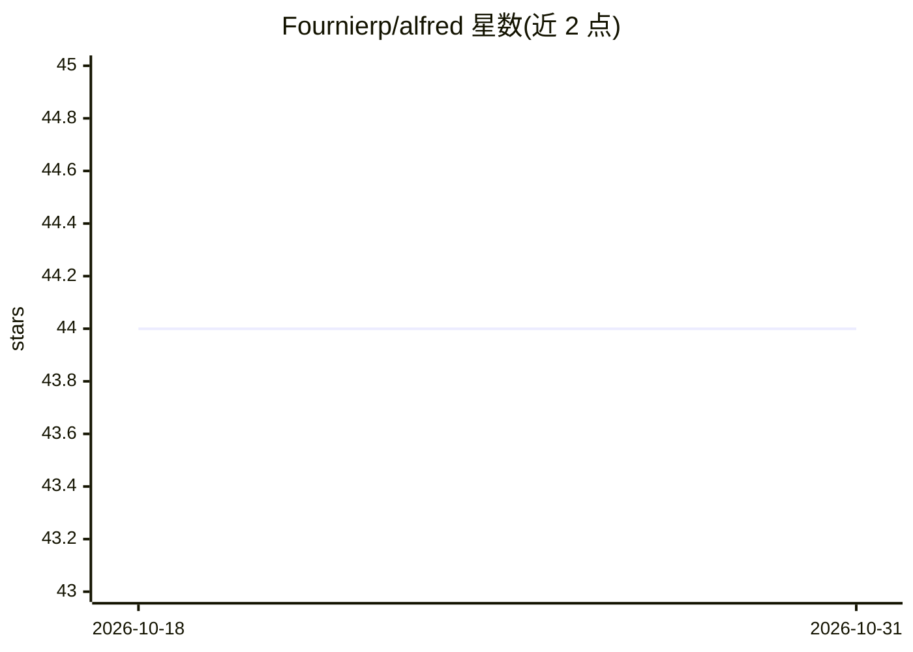

# Fournierp/alfred

⭐ 44 · Jupyter Notebook · Apache-2.0 · 推送 2025-12-02 · [GitHub](https://github.com/Fournierp/alfred) · 个人维护

**S&P 500 股票信息可视化与情感分析预测的 Web 应用**

基于 Streamlit 的个人股票市场投资信息仪表盘：可视化 S&P 500 公司近期股价变化，聚合 newsapi 新闻，使用情感分析模型用于股票预测（曾在 McGill 大学机器学习黑客马拉松 NLP 类别获第二名）。需自备 newsapi API key，通过 uv 安装依赖并运行，README 声明仅供信息与教育用途，不构成投资建议。

## 筛选速览

| 维度 | 判定 | 备注 |
|---|---|---|
| AI 角色 | `ai-enhanced` | 去掉 AI 部分产品仍成立 |
| 许可风险 | `permissive` | Apache-2.0 |
| 部署形态 | `None` |  |
| 模型依赖 | — | README 未给出锁定关系 |
| 硬件要求 | — | 无带数字的原话,不猜 |
| 安装摩擦 | `low` | 无编译、无系统依赖或容器化 |
| 成熟度 | — | 结构信号不足 |

## 能力要点

- S&P 500 公司股价变化可视化
- 聚合 newsapi 新闻文章
- 情感分析模型用于股票预测

## 适用场景

- 浏览 S&P 500 公司的股价走势
- 查看目标公司的相关新闻与情感分析结果
- 学习股票预测演示应用

## 场景标签

`金融量化` · 领域:学习与行业

## 证据(README 行号)

> L7: The implementation of efficient Sentiment Analysis models used for Stock Prediction earned me the Second Position in
> L11: Alfred is a web app designed with Streamlit. This web-interface serves as a personal virtual assistant to help you 

## 星数曲线

2026-10-18 44 → 2026-10-31 44（+0）

---
*卡片 v1 · prompt 1.4 · 生成 2026-10-25 · 置信度 mid · 依据 README sha `431ba3d38cfb` · [字段定义](../../DATASET.md)*
