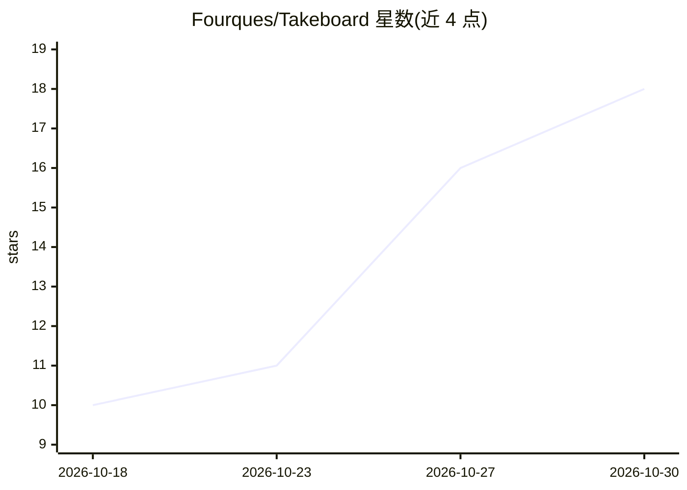

# Fourques/Takeboard

⭐ 18 · TypeScript · Apache-2.0 · 推送 2026-10-26 · [GitHub](https://github.com/Fourques/Takeboard) · [官网](https://fourques.github.io/Takeboard/) · 个人维护 · 中文 README

**基于 ComfyUI 的开源 AI 图片/视频创作画布桌面应用**

TakeBoard 是连接本机或远程 ComfyUI 的桌面端创作画布：用户在画布上放置参考素材、创建生成节点、连接输入、填写提示词，支持文生图、图生图、文生视频、图生视频等任务，生成结果可继续作为下一节点输入。提供推荐模板（Qwen Image、Wan 2.2 等）与自定义工作流导入（Workflow JSON、API Prompt JSON、PNG 元数据）。安装包不含 ComfyUI、模型或第三方节点，需用户自备生成环境；当前为 v0.2.0-beta.21，macOS 包未完成 Apple 公证。

## 筛选速览

| 维度 | 判定 | 备注 |
|---|---|---|
| AI 角色 | `ai-native` | 本体是模型或模型工具 |
| 许可风险 | `permissive` | Apache-2.0 |
| 部署形态 | `None` |  |
| 模型依赖 | — | README 未给出锁定关系 |
| 硬件要求 | — | 无带数字的原话,不猜 |
| 安装摩擦 | `low` | 无编译、无系统依赖或容器化 |
| 成熟度 | `idea` | |

## 能力要点

- 画布式多步创作：素材→生成节点→结果再连接
- 支持文生图/图生图/文生视频/图生视频/参考生成
- 导入自定义 ComfyUI 工作流（Workflow JSON / API Prompt JSON / PNG 元数据）
- 连接本机或远程 GPU 上的 ComfyUI，输出自动取回项目

## 适用场景

- 在一张画布上完成图片与视频的多步生成创作
- 用已配置好的 ComfyUI 工作流做日常创作，避免反复进入节点图
- 笔记本连接远程 GPU 服务器进行生成
- 保留多个生成尝试并比较、继续创作

## 场景标签

`图像生成` `视频生成` · 领域:内容生成

## 证据(README 行号)

> L7: TakeBoard 是基于 ComfyUI 的开源 AI 创作画布。在同一工作区选择模型、连接素材、编写提示词，生成图片与视频，再用结果继续创作。桌面应用连接你自己的本机或远程 ComfyUI，让日常创作围绕画面展开。
> L21: - **一张画布，完成多步创作。** 放入参考图片或视频，创建生成节点，连接输入、调整提示词与参数、查看结果。保留不同尝试，也可以将生成结果连接到下一个节点继续创作。
> L22: - **按创作任务选择模型。** 文生图、图生图、文生视频、图生视频和参考生成，按可用工作流展示相应输入与参数。推荐模板按需添加，也能导入自己的工作流；需要深入调整时再进入 ComfyUI。

## 星数曲线

2026-10-18 10 → 2026-10-30 18（+8）

---
*卡片 v1 · prompt 1.4 · 生成 2026-10-30 · 置信度 high · 依据 README sha `88c4a7190f75` · [字段定义](../../DATASET.md)*
