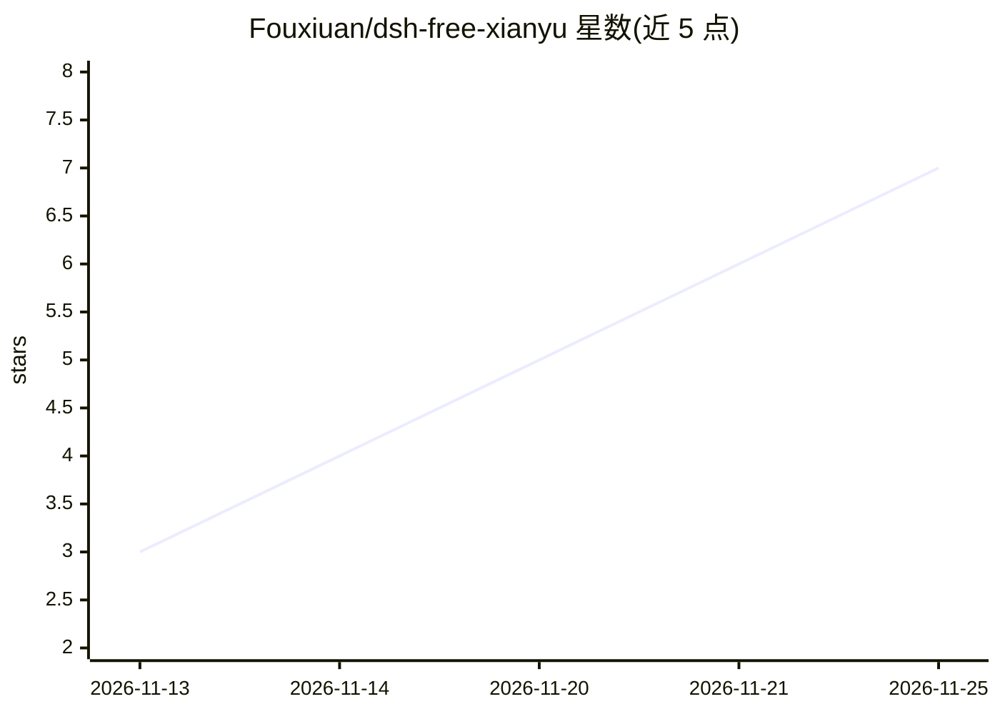

# Fouxiuan/dsh-free-xianyu

⭐ 7 · HTML · MIT · 推送 2026-11-14 · [GitHub](https://github.com/Fouxiuan/dsh-free-xianyu) · 个人维护 · 中文 README

**把闲鱼二手商品监控装进 DeepSeek Harness 的免费模型插件**

作为 DeepSeek Harness 插件运行：内置 ai-goofish-monitor 上游源码，首次启动自动创建 Python 虚拟环境、安装依赖并布置工作目录，无需手动克隆仓库。提供 13 个 goofish_* Agent 工具（建任务/跑抓取/读结果/切模型）和侧边栏面板；AI 商品分析通过 dsh-our-free-model 的本地网关接入免费视觉模型，写入 OpenAI 兼容 .env，不要求用户自备付费 API Key。跑抓取任务需通过 Chrome 扩展导出闲鱼登录态，无登录态时服务与日志仍可查看。

## 筛选速览

| 维度 | 判定 | 备注 |
|---|---|---|
| AI 角色 | `ai-native` | 本体是模型或模型工具 |
| 许可风险 | `permissive` | MIT |
| 部署形态 | `library` | 以包/库形式分发 |
| 模型依赖 | — | README 未给出锁定关系 |
| 硬件要求 | — | 无带数字的原话,不猜 |
| 安装摩擦 | `low` | 无编译、无系统依赖或容器化 |
| 成熟度 | — | 结构信号不足 |

## 能力要点

- 内置上游代码，一条 dsh plugin add 命令安装，首次启动自动建 venv 装依赖
- 13 个 Agent 工具供模型直接建任务、跑抓取、读结果、切模型
- 自动发现 dsh-our-free-model 本地网关并挑选带视觉能力的免费模型
- 侧边栏面板每 5 秒刷新服务状态、任务列表、结果与日志

## 适用场景

- 监控闲鱼上特定型号、价格区间的二手商品并由 AI 筛选
- 不买付费 API Key，用免费模型车道跑商品分析
- 在 Harness 对话里直接说需求让模型代为建任务跑抓取

## 场景标签

`网页抓取` · 领域:效率与自动化

## 证据(README 行号)

> L8: 把闲鱼（Goofish）二手商品监控做成 **DeepSeek Harness 插件**：装进 Harness 后，左侧导航多一个
> L56: - **13 个 Agent 工具**：模型可以直接建任务、跑任务、读结果、看日志、切模型、初始化环境、构建前端。
> L57: - **免费模型接入**：自动发现 dsh-our-free-model 的本地网关（`chanGateway.relay` 或 `forward`），

## 星数曲线

2026-11-13 3 → 2026-11-25 7（+4）

---
*卡片 v1 · prompt 1.4 · 生成 2026-11-21 · 置信度 mid · 依据 README sha `fbc8b80f6a34` · [字段定义](../../DATASET.md)*
