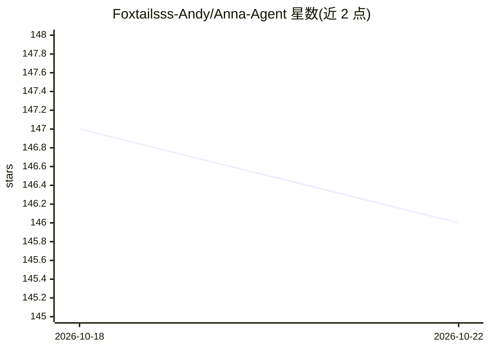

# Foxtailsss-Andy/Anna-Agent

⭐ 146 · TypeScript · MIT · 推送 2026-10-09 · [GitHub](https://github.com/Foxtailsss-Andy/Anna-Agent) · [官网](https://foxtailsss-andy.github.io/Anna/) · 个人维护 · 中文 README

**本地优先的桌面 AI agent，管理个人任务与团队项目协作**

个人开源项目 Anna 的实验性源码预览：Electron 桌面应用提供 Home（个人任务与本地文件分析）、Cowork（通过 MCP 连接业务系统展示客户/合同数据）、Crew（团队项目、任务依赖图与工件评审）三个工作区。任务经由 decide→act→observe 循环推进，Harness 提供上下文、权限、沙箱执行与结果校验；模型配置在本地完成，当前文档以 DeepSeek 经 OpenAI 兼容通道接入。仅验证 macOS arm64，构建未签名，处于活跃开发期，面向探索该项目的开发者。

## 筛选速览

| 维度 | 判定 | 备注 |
|---|---|---|
| AI 角色 | `ai-native` | 本体是模型或模型工具 |
| 许可风险 | `permissive` | MIT |
| 部署形态 | `desktop` | 安装包/桌面程序 |
| 模型依赖 | locked-api |  |
| 硬件要求 | — | 无带数字的原话,不猜 |
| 安装摩擦 | `low` | 无编译、无系统依赖或容器化 |
| 成熟度 | `idea` | |

## 能力要点

- Home/Cowork/Crew 三工作区：个人任务、业务系统连接、团队协作
- decide→act→observe 循环 + Harness 权限、沙箱与执行预算控制
- 沙箱内用 Python 读取本地 CSV 并生成分析报告
- Crew 支持任务依赖图、工件版本化评审与 Jev 指派人建议

## 适用场景

- 把对话中的任务推进到可评审的分析报告或工件
- 通过 MCP 连接器在业务数据旁完成跟进工作
- 团队项目中协调任务依赖、通道讨论与交付物评审

## 场景标签

`AI 助手` · 领域:对话与助手

## 证据(README 行号)

> L5: Anna is a personal open-source project exploring how an AI agent can carry work from a conversation through to a rev
> L112: Anna advances a task through a **decide → act → observe → decide again** loop. The **Harness** surrounds that loop

## 星数曲线

2026-10-18 147 → 2026-10-22 146（-1）

---
*卡片 v1 · prompt 1.4 · 生成 2026-10-22 · 置信度 high · 依据 README sha `53ccac1d63d5` · [字段定义](../../DATASET.md)*
