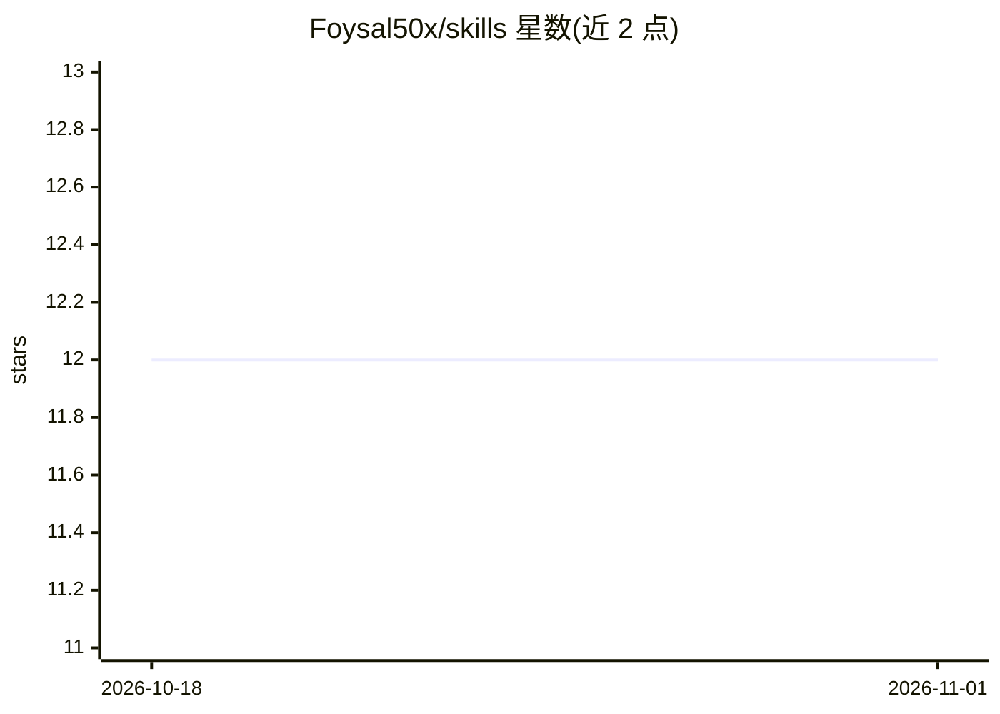

# Foysal50x/skills

⭐ 12 · JavaScript · MIT · 推送 2026-10-29 · [GitHub](https://github.com/Foysal50x/skills) · 个人维护

**面向 AI 编程 agent 的 Laravel 工程规则技能包（209 条规则+写作技能）**

遵循 Agent Skills（SKILL.md）格式的技能集合：一个 12 条规则的 humanize-ai-writing 写作技能，以及六个 Laravel 工程技能（engineering/patterns/eloquent/rest-api/async/testing）共 209 条规则，覆盖 DDD 类放置、N+1 消除、队列与缓存、测试策略等。规则以 Laravel ^12/^13、PHP ^8.3 为基线，Laravel 13 专有特性行内标注。可通过 npx skills、Claude Code 插件市场、OpenAI 插件打包或手动复制安装，兼容任何读取 SKILL.md 的 agent。

## 筛选速览

| 维度 | 判定 | 备注 |
|---|---|---|
| AI 角色 | `ai-knowledge` | 知识聚合/清单类 |
| 许可风险 | `permissive` | MIT |
| 部署形态 | `library` | 以包/库形式分发 |
| 模型依赖 | — | README 未给出锁定关系 |
| 硬件要求 | — | 无带数字的原话,不猜 |
| 安装摩擦 | `low` | 无编译、无系统依赖或容器化 |
| 成熟度 | — | 结构信号不足 |

## 能力要点

- 6 个 Laravel 技能共 209 条规则，附 1 个多语言写作技能
- SKILL.md 控制在 500 行内，细节按需从 rules/ 与 references/ 加载
- 提供 npm 脚本做规则编译、交叉一致性 lint 与测试（CI 强制 AGENTS.md 不陈旧）
- 多渠道安装：skills.sh、Claude Code 插件、OpenAI 插件导出、手动复制

## 适用场景

- 让我的编程 agent 按 Laravel DDD 规范决定 Action/Service/Repository 的取舍
- 为 agent 注入 Eloquent 查询性能与迁移的工程规则
- 用 AI 改写文本但保留事实、语气与语言习惯

## 场景标签

`AI 写作` `提示工程` · 领域:Agent 开发

## 证据(README 行号)

> L3: Reusable writing and Laravel engineering skills for AI agents. Includes `humanize-ai-writing` and 209 Laravel rules 
> L5: Skills follow the Agent Skills format and work with Claude Code, Cursor, Copilot and anything else that reads `SKILL

## 星数曲线

2026-10-18 12 → 2026-11-01 12（+0）

---
*卡片 v1 · prompt 1.4 · 生成 2026-11-01 · 置信度 high · 依据 README sha `c3592ee2995a` · [字段定义](../../DATASET.md)*
